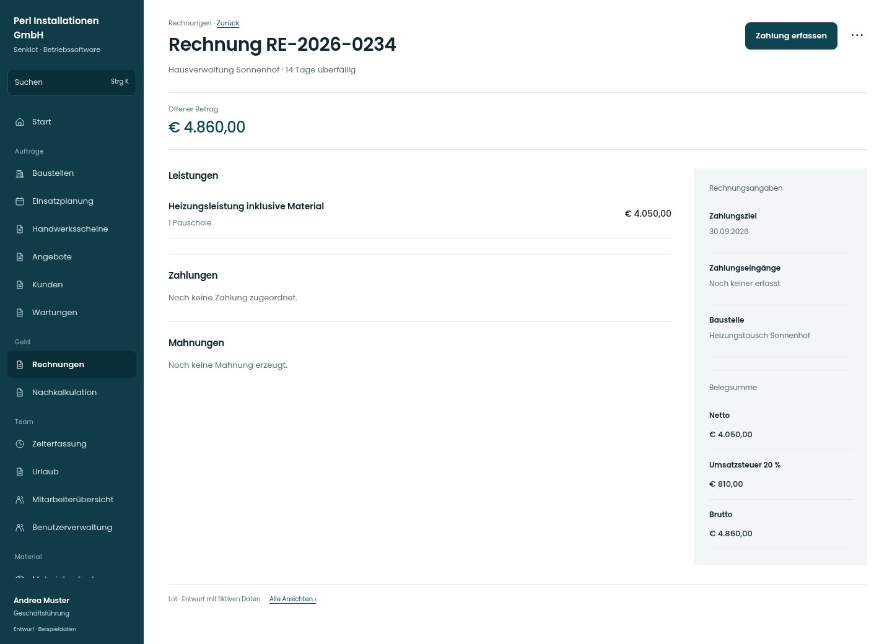

# Rechnung RE-2026-0234

[Zur Übersicht](../README.md) · [Bereich: Rechnungen](../bereiche/rechnungen.md)

**Rechnungen · Geschäftsführung · /invoices · Detail**

Gestaltungsentwurf mit fiktiven Beispieldaten. Aktionen und Datenänderungen sind lokal simuliert, ohne Backend.

[Desktop](../bilder/082-rechnung-detail-desktop.jpg) · [Tablet](../bilder/082-rechnung-detail-tablet.jpg) · [Mobil](../bilder/082-rechnung-detail-mobil.jpg)

## Aufbau

Leistungspositionen und Belegsumme ergänzen, PDF sichtbar; Bankgarantie nur im separaten passenden Rücklasszustand anbieten.

## Vorhandene Funktionen für die spätere Umsetzung erhalten

- Teilzahlungen/Rückzahlungen
- Guthaben
- Rabatt/Skonto/Rücklass
- Mahnverlauf
- Stornobelege

## Aktionen

- Zahlung erfassen
- Mahnung prüfen
- Stornieren
- E-Rechnung (ebInterface)
- PDF laden

## Quellen

Quellstand: `3e49090`.
- [src/features/invoices/RechnungDetail.tsx](https://github.com/juliandeutsch22/Prototype-App-Installateure/blob/3e49090d4054ebbd3ecbce6ab583bb944c2c0770/src/features/invoices/RechnungDetail.tsx)
- [src/features/invoices/InvoicesView.tsx](https://github.com/juliandeutsch22/Prototype-App-Installateure/blob/3e49090d4054ebbd3ecbce6ab583bb944c2c0770/src/features/invoices/InvoicesView.tsx)

Die Screens zeigen die vorgesehenen Bedienwege. Reale Speicherung, vollständige Rollenprüfung, Berechnungen, Exporte, Benachrichtigungen und Integrationen müssen bei einer Umsetzung gegen die App geprüft werden.
