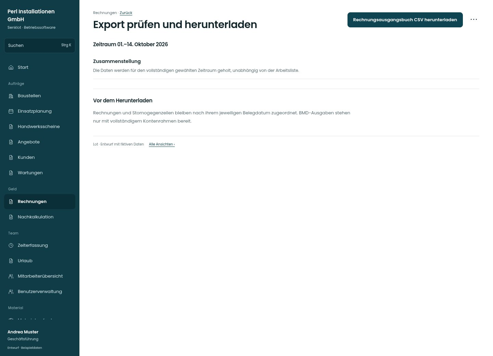

# Export prüfen und herunterladen

[Zur Übersicht](../README.md) · [Bereich: Rechnungen](../bereiche/rechnungen.md)

**Rechnungen · Geschäftsführung · /invoices · Export**

Gestaltungsentwurf mit fiktiven Beispieldaten. Aktionen und Datenänderungen sind lokal simuliert, ohne Backend.

[Desktop](../bilder/206-rechnung-export-ergebnis-desktop.jpg) · [Tablet](../bilder/206-rechnung-export-ergebnis-tablet.jpg) · [Mobil](../bilder/206-rechnung-export-ergebnis-mobil.jpg)

## Aufbau

Zusammenstellung und Validierung vor getrennten Dateiformaten zeigen; fehlender Kontenrahmen sperrt die betroffene Ausgabe.

## Vorhandene Funktionen für die spätere Umsetzung erhalten

- Bestehende Formate unverändert
- Konten-/Debitoren-/Steuercodeprüfung
- Datumsbereich und Stornos

## Aktionen

- Rechnungsausgangsbuch CSV herunterladen
- BMD-Buchungsstapel herunterladen
- Zahlungsstapel herunterladen

## Quellen

Quellstand: `3e49090`.
- [src/features/invoices/InvoicesView.tsx](https://github.com/juliandeutsch22/Prototype-App-Installateure/blob/3e49090d4054ebbd3ecbce6ab583bb944c2c0770/src/features/invoices/InvoicesView.tsx)

Die Screens zeigen die vorgesehenen Bedienwege. Reale Speicherung, vollständige Rollenprüfung, Berechnungen, Exporte, Benachrichtigungen und Integrationen müssen bei einer Umsetzung gegen die App geprüft werden.
