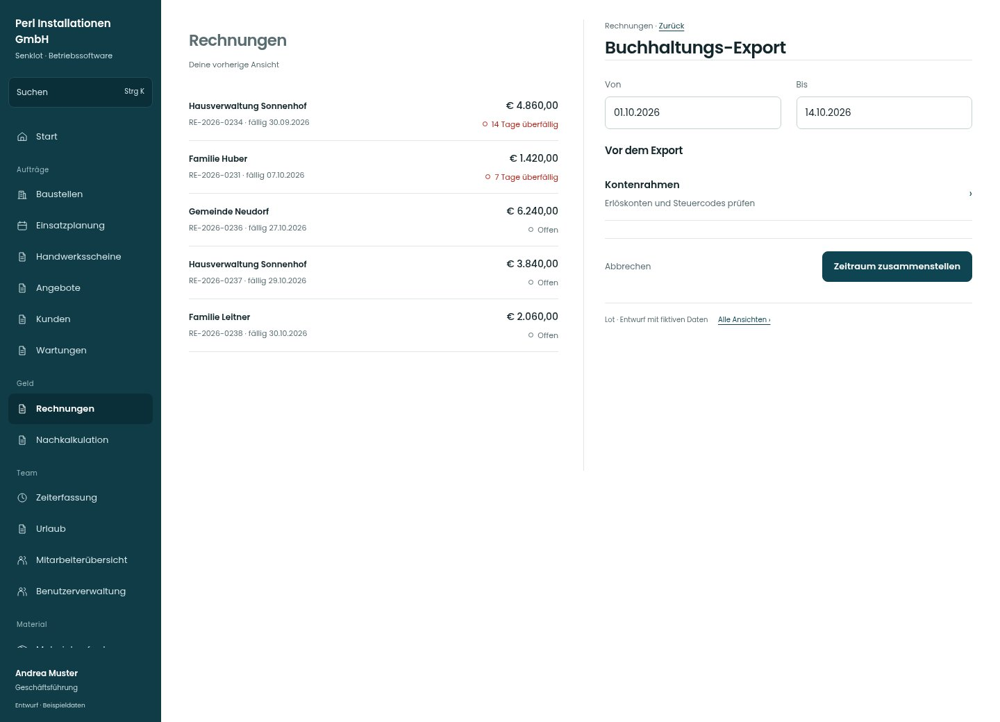

# Buchhaltungs-Export

[Zur Übersicht](../README.md) · [Bereich: Rechnungen](../bereiche/rechnungen.md)

**Rechnungen · Geschäftsführung · /invoices · Export**

Gestaltungsentwurf mit fiktiven Beispieldaten. Aktionen und Datenänderungen sind lokal simuliert, ohne Backend.

[Desktop](../bilder/093-rechnung-export-desktop.jpg) · [Tablet](../bilder/093-rechnung-export-tablet.jpg) · [Mobil](../bilder/093-rechnung-export-mobil.jpg)

## Aufbau

Zeitraum und Kontenprüfung vor den Dateien halten; Gesamtexport nicht auf zufällig geladene Listentreffer begrenzen.

## Vorhandene Funktionen für die spätere Umsetzung erhalten

- Bestehende Formate unverändert
- Konten-/Debitoren-/Steuercodeprüfung
- Datumsbereich und Stornos

## Felder im Beispiel

- Von
- Bis

## Aktionen

- Zeitraum zusammenstellen

## Quellen

Quellstand: `3e49090`.
- [src/features/invoices/InvoicesView.tsx](https://github.com/juliandeutsch22/Prototype-App-Installateure/blob/3e49090d4054ebbd3ecbce6ab583bb944c2c0770/src/features/invoices/InvoicesView.tsx)

Die Screens zeigen die vorgesehenen Bedienwege. Reale Speicherung, vollständige Rollenprüfung, Berechnungen, Exporte, Benachrichtigungen und Integrationen müssen bei einer Umsetzung gegen die App geprüft werden.
