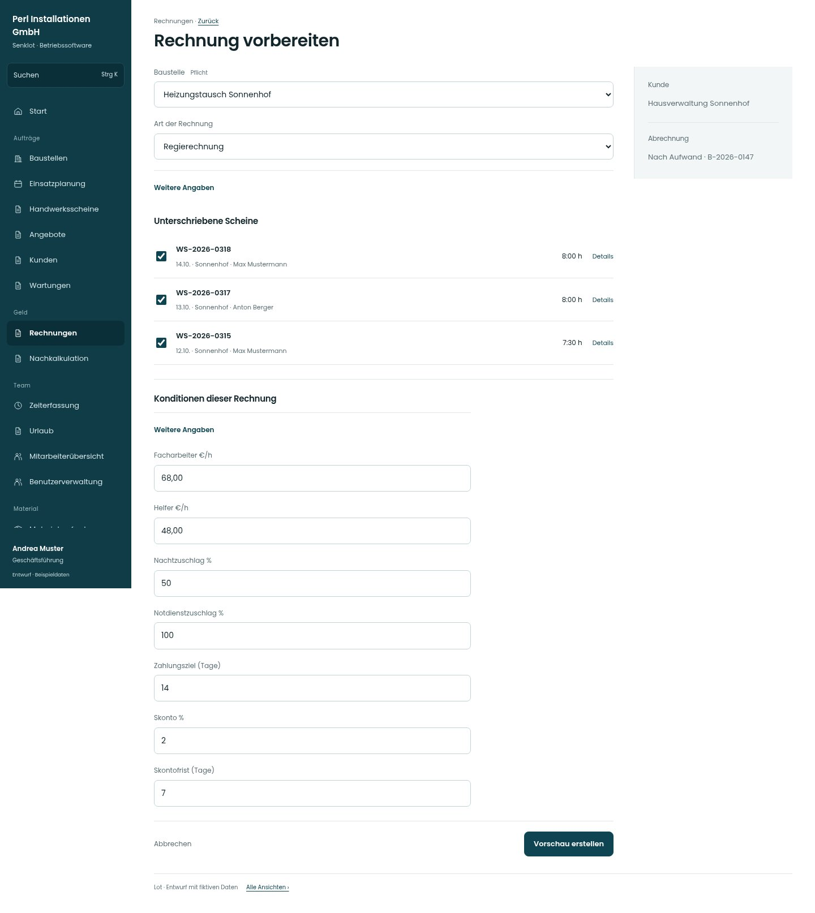

# Rechnung vorbereiten

[Zur Übersicht](../README.md) · [Bereich: Rechnungen](../bereiche/rechnungen.md)

**Rechnungen · Geschäftsführung · /invoices · Neue Rechnung**

Gestaltungsentwurf mit fiktiven Beispieldaten. Aktionen und Datenänderungen sind lokal simuliert, ohne Backend.

[Desktop](../bilder/084-rechnung-neu-desktop.jpg) · [Tablet](../bilder/084-rechnung-neu-tablet.jpg) · [Mobil](../bilder/084-rechnung-neu-mobil.jpg)

## Aufbau

Unterschriebene Scheine auswählbar darstellen; Konditionen bleiben beim Beleg, Vorschau vor verbindlicher Erstellung.

## Vorhandene Funktionen für die spätere Umsetzung erhalten

- Regie/Pauschale/Anzahlung/Teil/Schluss
- Scheinabgleich
- Konditionen aus Bestand
- Keine Nummernvergabe vor Erstellung

## Felder im Beispiel

- Baustelle (Pflichtfeld)
- Art der Rechnung
- Anteil vom angenommenen Angebot (%)
- Facharbeiter €/h
- Helfer €/h
- Nachtzuschlag %
- Notdienstzuschlag %
- Zahlungsziel (Tage)
- Skonto %
- Skontofrist (Tage)

## Aktionen

- Vorschau erstellen

## Quellen

Quellstand: `3e49090`.
- [src/features/invoices/InvoicesView.tsx](https://github.com/juliandeutsch22/Prototype-App-Installateure/blob/3e49090d4054ebbd3ecbce6ab583bb944c2c0770/src/features/invoices/InvoicesView.tsx)

Die Screens zeigen die vorgesehenen Bedienwege. Reale Speicherung, vollständige Rollenprüfung, Berechnungen, Exporte, Benachrichtigungen und Integrationen müssen bei einer Umsetzung gegen die App geprüft werden.
