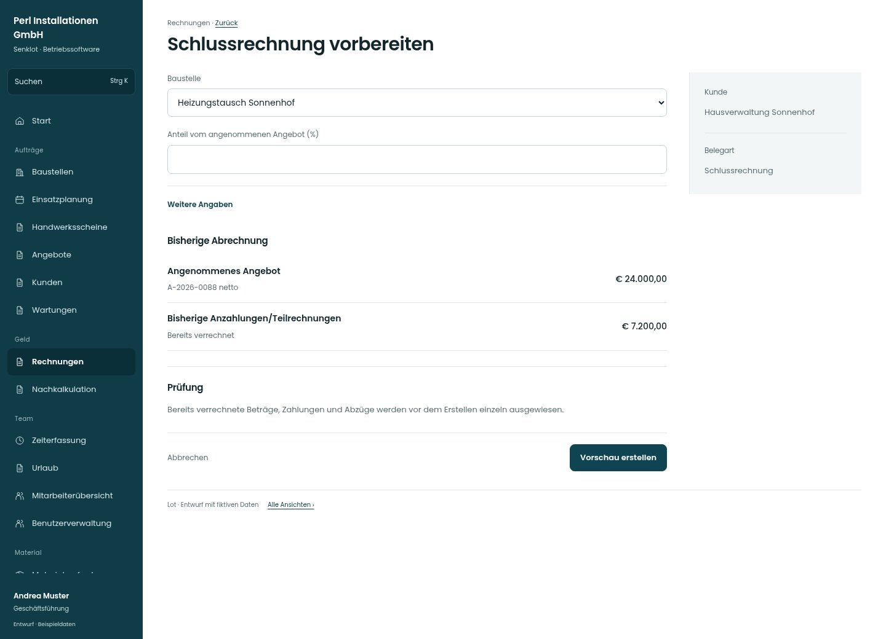

# Schlussrechnung vorbereiten

[Zur Übersicht](../README.md) · [Bereich: Rechnungen](../bereiche/rechnungen.md)

**Rechnungen · Geschäftsführung · /invoices · Schlussrechnung**

Gestaltungsentwurf mit fiktiven Beispieldaten. Aktionen und Datenänderungen sind lokal simuliert, ohne Backend.

[Desktop](../bilder/088-rechnung-schluss-desktop.jpg) · [Tablet](../bilder/088-rechnung-schluss-tablet.jpg) · [Mobil](../bilder/088-rechnung-schluss-mobil.jpg)

## Aufbau

Vorbelege, Anzahlungsabzug und Schlussbetrag vor Erstellung nachvollziehen; bestehende Besteuerung nicht neu interpretieren.

## Vorhandene Funktionen für die spätere Umsetzung erhalten

- Betriebsfreigabe für Teil-/Schlussrechnungen
- Keine doppelte Verrechnung
- Vorbelege und Anzahlungsabzüge
- Kein neuer Berechnungsweg

## Felder im Beispiel

- Baustelle
- Anteil vom angenommenen Angebot (%)
- Bestellnummer des Kunden

## Aktionen

- Vorschau erstellen

## Quellen

Quellstand: `3e49090`.
- [src/features/invoices/InvoicesView.tsx](https://github.com/juliandeutsch22/Prototype-App-Installateure/blob/3e49090d4054ebbd3ecbce6ab583bb944c2c0770/src/features/invoices/InvoicesView.tsx)
- [src/features/invoices/anzahlung.ts](https://github.com/juliandeutsch22/Prototype-App-Installateure/blob/3e49090d4054ebbd3ecbce6ab583bb944c2c0770/src/features/invoices/anzahlung.ts)
- [src/features/invoices/vorrechnungen.ts](https://github.com/juliandeutsch22/Prototype-App-Installateure/blob/3e49090d4054ebbd3ecbce6ab583bb944c2c0770/src/features/invoices/vorrechnungen.ts)

Die Screens zeigen die vorgesehenen Bedienwege. Reale Speicherung, vollständige Rollenprüfung, Berechnungen, Exporte, Benachrichtigungen und Integrationen müssen bei einer Umsetzung gegen die App geprüft werden.
