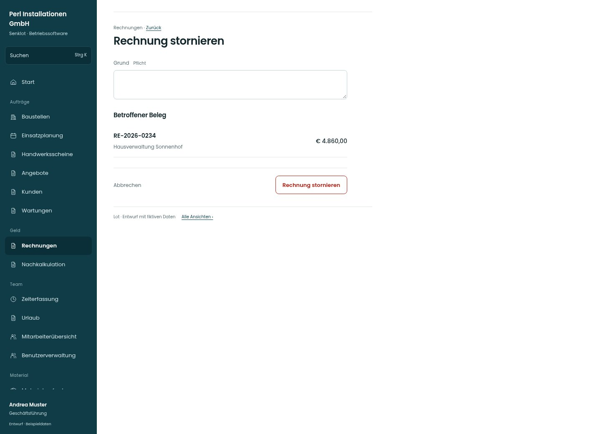

# Rechnung stornieren

[Zur Übersicht](../README.md) · [Bereich: Rechnungen](../bereiche/rechnungen.md)

**Rechnungen · Geschäftsführung · /invoices · Rechnung stornieren**

Gestaltungsentwurf mit fiktiven Beispieldaten. Aktionen und Datenänderungen sind lokal simuliert, ohne Backend.

[Desktop](../bilder/095-rechnung-storno-desktop.jpg) · [Tablet](../bilder/095-rechnung-storno-tablet.jpg) · [Mobil](../bilder/095-rechnung-storno-mobil.jpg)

## Aufbau

Betroffenen Beleg, Pflichtgrund und Wirkung vor der Bestätigung zeigen; vorhandene Archiv- und Zahlungszusammenhänge nicht lösen.

## Vorhandene Funktionen für die spätere Umsetzung erhalten

- Je Zustand getrennte zulässige Aktion
- BMD-/Belegarchiv bleibt nachvollziehbar
- Bestätigung bleibt verbindlich

## Felder im Beispiel

- Grund (Pflichtfeld)

## Aktionen

- Rechnung stornieren

## Quellen

Quellstand: `3e49090`.
- [src/features/invoices/InvoicesView.tsx](https://github.com/juliandeutsch22/Prototype-App-Installateure/blob/3e49090d4054ebbd3ecbce6ab583bb944c2c0770/src/features/invoices/InvoicesView.tsx)

Die Screens zeigen die vorgesehenen Bedienwege. Reale Speicherung, vollständige Rollenprüfung, Berechnungen, Exporte, Benachrichtigungen und Integrationen müssen bei einer Umsetzung gegen die App geprüft werden.
