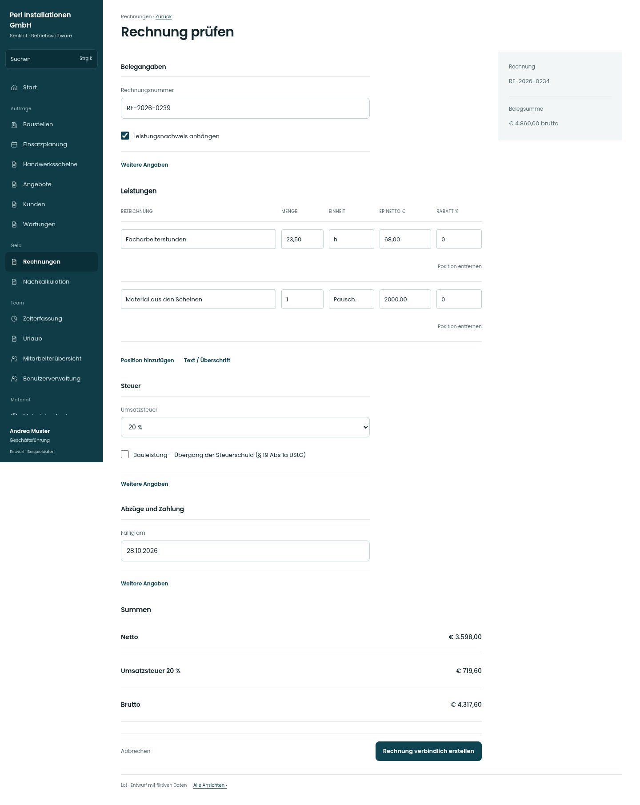

# Rechnung prüfen

[Zur Übersicht](../README.md) · [Bereich: Rechnungen](../bereiche/rechnungen.md)

**Rechnungen · Geschäftsführung · /invoices · Vorschau**

Gestaltungsentwurf mit fiktiven Beispieldaten. Aktionen und Datenänderungen sind lokal simuliert, ohne Backend.

[Desktop](../bilder/085-rechnung-vorschau-desktop.jpg) · [Tablet](../bilder/085-rechnung-vorschau-tablet.jpg) · [Mobil](../bilder/085-rechnung-vorschau-mobil.jpg)

## Aufbau

Belegangaben, Positionen, Steuer, Abzüge und Summen nachvollziehbar ordnen; eine klare verbindliche Erstellung am Ende.

## Vorhandene Funktionen für die spätere Umsetzung erhalten

- Nummernprüfung und Empfänger-/Firmensperren
- Material-/Leistungspositionen bearbeitbar nach Bestandsregeln
- Reverse Charge nur bei gültigen Voraussetzungen
- Skonto/Rabatt/Rücklass
- Serverwerte maßgeblich

## Felder im Beispiel

- Rechnungsnummer
- Leistungsnachweis anhängen
- Umsatzsteuer
- Bauleistung – Übergang der Steuerschuld (§ 19 Abs 1a UStG)
- UID-Nummer des Kunden
- Grund der Steuerbefreiung
- Bestellnummer des Kunden
- Rabatt – Bezeichnung
- Rabattart
- Rabattwert
- Rücklass (%)
- Fällig am

## Aktionen

- Rechnung verbindlich erstellen

## Quellen

Quellstand: `3e49090`.
- [src/features/invoices/InvoicesView.tsx](https://github.com/juliandeutsch22/Prototype-App-Installateure/blob/3e49090d4054ebbd3ecbce6ab583bb944c2c0770/src/features/invoices/InvoicesView.tsx)

Die Screens zeigen die vorgesehenen Bedienwege. Reale Speicherung, vollständige Rollenprüfung, Berechnungen, Exporte, Benachrichtigungen und Integrationen müssen bei einer Umsetzung gegen die App geprüft werden.
