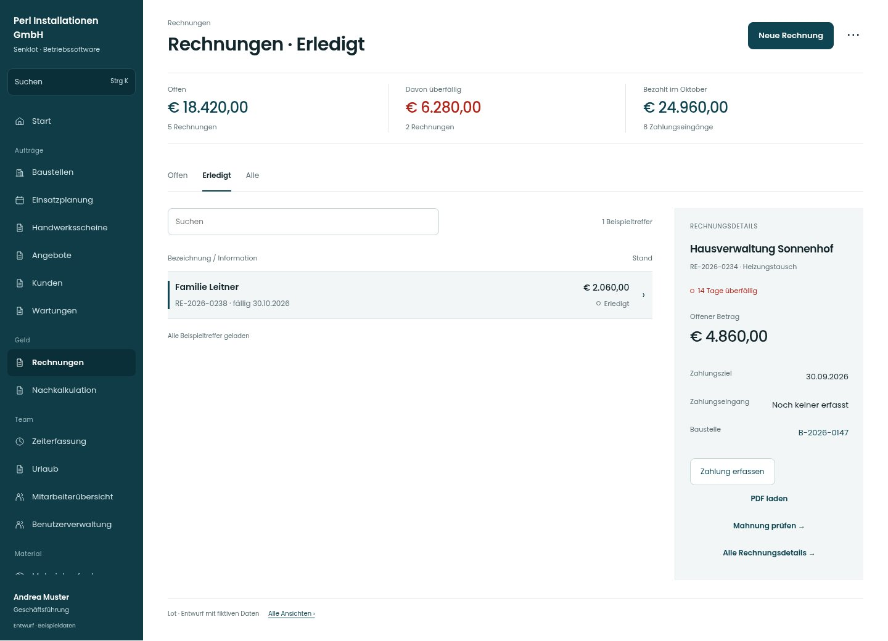

# Rechnungen · Erledigt

[Zur Übersicht](../README.md) · [Bereich: Rechnungen](../bereiche/rechnungen.md)

**Rechnungen · Geschäftsführung · /invoices**

Gestaltungsentwurf mit fiktiven Beispieldaten. Aktionen und Datenänderungen sind lokal simuliert, ohne Backend.

[Desktop](../bilder/229-rechnungen-filter-1-desktop.jpg) · [Tablet](../bilder/229-rechnungen-filter-1-tablet.jpg) · [Mobil](../bilder/229-rechnungen-filter-1-mobil.jpg)

## Aufbau

Vergleichbare Belegzeilen, Auswahl und Details mit Zahlung/PDF am Beleg; Liste und Auswertung nicht mit doppelten Summen überfrachten.

## Vorhandene Funktionen für die spätere Umsetzung erhalten

- Alle bisherigen Filter/Status
- Nicht verrechnete Leistung
- Mahnlauf
- Suche über alle
- Beleg- und Stornoaktionen

## Register und Filter

- Offen → [rechnungen](rechnungen.md)
- Erledigt → [rechnungen-filter-1](rechnungen-filter-1.md)
- Alle → [rechnungen-filter-2](rechnungen-filter-2.md)

## Aktionen

- Neue Rechnung
- Buchhaltungs-Export

## Quellen

Quellstand: `3e49090`.
- [src/features/invoices/InvoicesView.tsx](https://github.com/juliandeutsch22/Prototype-App-Installateure/blob/3e49090d4054ebbd3ecbce6ab583bb944c2c0770/src/features/invoices/InvoicesView.tsx)
- [src/features/invoices/RechnungsListe.tsx](https://github.com/juliandeutsch22/Prototype-App-Installateure/blob/3e49090d4054ebbd3ecbce6ab583bb944c2c0770/src/features/invoices/RechnungsListe.tsx)
- [src/features/invoices/RechnungDetail.tsx](https://github.com/juliandeutsch22/Prototype-App-Installateure/blob/3e49090d4054ebbd3ecbce6ab583bb944c2c0770/src/features/invoices/RechnungDetail.tsx)

Die Screens zeigen die vorgesehenen Bedienwege. Reale Speicherung, vollständige Rollenprüfung, Berechnungen, Exporte, Benachrichtigungen und Integrationen müssen bei einer Umsetzung gegen die App geprüft werden.
