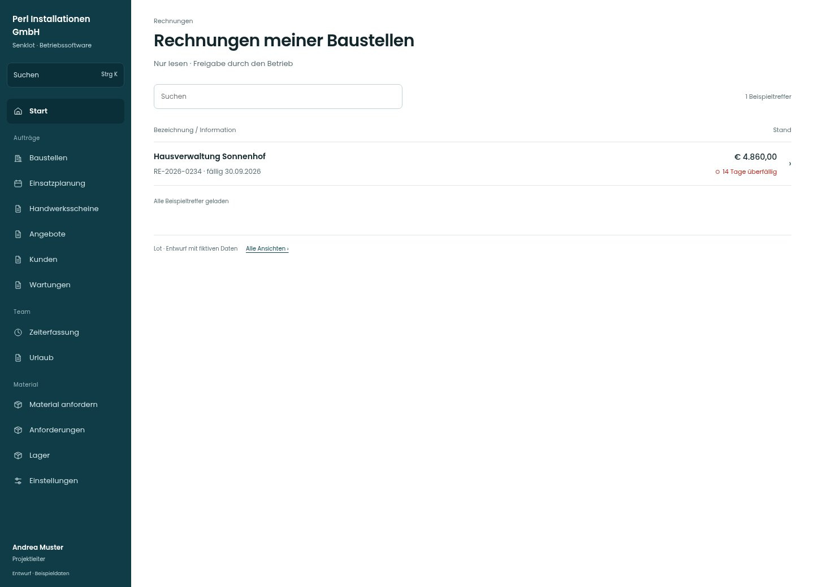

# Rechnungen meiner Baustellen

[Zur Übersicht](../README.md) · [Bereich: Rechnungen](../bereiche/rechnungen.md)

**Rechnungen · Projektleiter · /invoices · Projektleitung**

Gestaltungsentwurf mit fiktiven Beispieldaten. Aktionen und Datenänderungen sind lokal simuliert, ohne Backend.

[Desktop](../bilder/083-rechnungen-lesen-desktop.jpg) · [Tablet](../bilder/083-rechnungen-lesen-tablet.jpg) · [Mobil](../bilder/083-rechnungen-lesen-mobil.jpg)

## Aufbau

Lesende Projektleitung erhält eine reine Belegansicht; kein Wechsel auf eine Zahlungs-/Stornoseite der Geschäftsführung.

## Vorhandene Funktionen für die spätere Umsetzung erhalten

- Nur mit rechnungenLesen
- Nur eigene Baustellen
- Keine Erstell-/Zahlungs-/Stornoaktionen

## Quellen

Quellstand: `3e49090`.
- [src/features/invoices/RechnungenLesen.tsx](https://github.com/juliandeutsch22/Prototype-App-Installateure/blob/3e49090d4054ebbd3ecbce6ab583bb944c2c0770/src/features/invoices/RechnungenLesen.tsx)
- [src/features/invoices/RechnungenSeite.tsx](https://github.com/juliandeutsch22/Prototype-App-Installateure/blob/3e49090d4054ebbd3ecbce6ab583bb944c2c0770/src/features/invoices/RechnungenSeite.tsx)

Die Screens zeigen die vorgesehenen Bedienwege. Reale Speicherung, vollständige Rollenprüfung, Berechnungen, Exporte, Benachrichtigungen und Integrationen müssen bei einer Umsetzung gegen die App geprüft werden.
