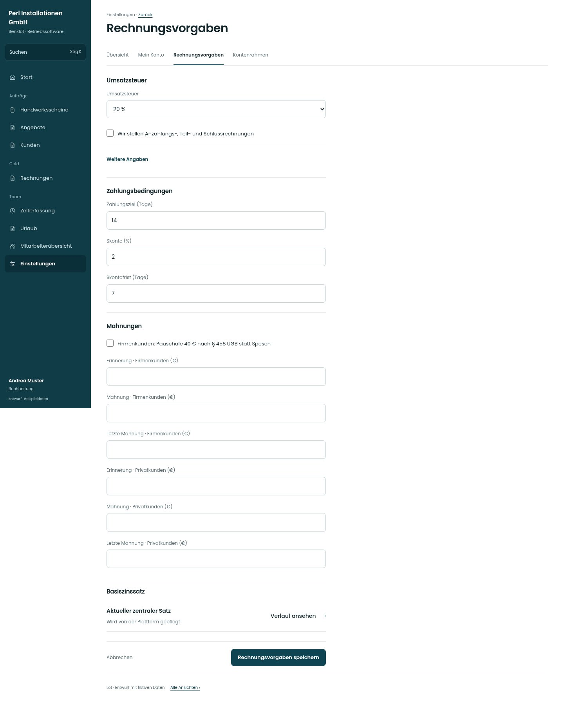

# Rechnungsvorgaben

[Zur Übersicht](../README.md) · [Bereich: Einstellungen](../bereiche/einstellungen.md)

**Einstellungen · Buchhaltung · /settings/rechnung**

Gestaltungsentwurf mit fiktiven Beispieldaten. Aktionen und Datenänderungen sind lokal simuliert, ohne Backend.

[Desktop](../bilder/139-rechnungsvorgaben-desktop.jpg) · [Tablet](../bilder/139-rechnungsvorgaben-tablet.jpg) · [Mobil](../bilder/139-rechnungsvorgaben-mobil.jpg)

## Aufbau

Steuer, Zahlungsbedingungen und Mahnungen gegliedert erhalten; bestehende Firmen-/Privatkundenregeln nicht vereinfachen.

## Vorhandene Funktionen für die spätere Umsetzung erhalten

- Privat-/Firmenkunde getrennt
- Zentrale Basiszinsen nicht lokal erfinden
- Historie/Gültigkeit
- Keine Stundensätze für Buchhaltung

## Register und Filter

- Übersicht → [einstellungen](einstellungen.md)
- Mein Konto → [konto](konto.md)
- Rechnungsvorgaben → [rechnungsvorgaben](rechnungsvorgaben.md)
- Kontenrahmen → [kontenrahmen](kontenrahmen.md)

## Felder im Beispiel

- Umsatzsteuer
- Grund der Steuerbefreiung
- Wir stellen Anzahlungs-, Teil- und Schlussrechnungen
- Zahlungsziel (Tage)
- Skonto (%)
- Skontofrist (Tage)
- Firmenkunden: Pauschale 40 € nach § 458 UGB statt Spesen
- Erinnerung · Firmenkunden (€)
- Mahnung · Firmenkunden (€)
- Letzte Mahnung · Firmenkunden (€)
- Erinnerung · Privatkunden (€)
- Mahnung · Privatkunden (€)
- Letzte Mahnung · Privatkunden (€)

## Aktionen

- Rechnungsvorgaben speichern

## Quellen

Quellstand: `3e49090`.
- [src/features/settings/SettingsView.tsx](https://github.com/juliandeutsch22/Prototype-App-Installateure/blob/3e49090d4054ebbd3ecbce6ab583bb944c2c0770/src/features/settings/SettingsView.tsx)
- [src/features/settings/BasiszinsVerlauf.tsx](https://github.com/juliandeutsch22/Prototype-App-Installateure/blob/3e49090d4054ebbd3ecbce6ab583bb944c2c0770/src/features/settings/BasiszinsVerlauf.tsx)

Die Screens zeigen die vorgesehenen Bedienwege. Reale Speicherung, vollständige Rollenprüfung, Berechnungen, Exporte, Benachrichtigungen und Integrationen müssen bei einer Umsetzung gegen die App geprüft werden.
