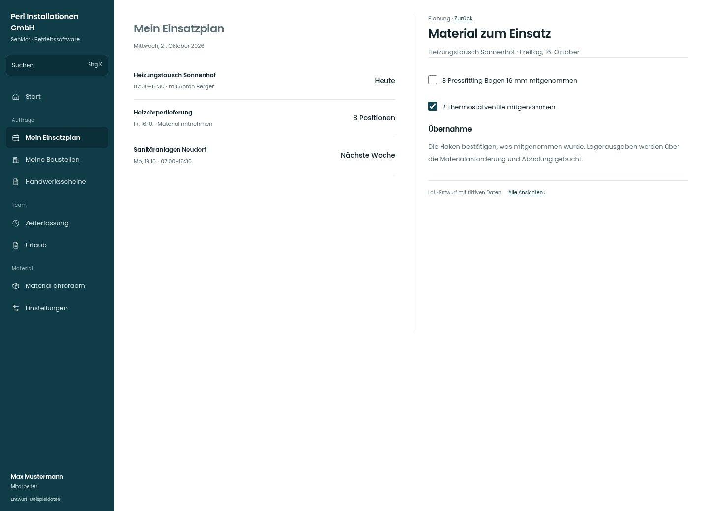

# Material zum Einsatz

[Zur Übersicht](../README.md) · [Bereich: Planung](../bereiche/planung.md)

**Planung · Mitarbeiter · /my-schedule · Rüstliste**

Gestaltungsentwurf mit fiktiven Beispieldaten. Aktionen und Datenänderungen sind lokal simuliert, ohne Backend.

[Desktop](../bilder/045-ruestliste-abhaken-desktop.jpg) · [Tablet](../bilder/045-ruestliste-abhaken-tablet.jpg) · [Mobil](../bilder/045-ruestliste-abhaken-mobil.jpg)

## Aufbau

Einzelne Mitnahmehaken sind der Arbeitsvorgang; keine zusätzliche pauschale Bestätigung mit unklarer Bestandswirkung vorschalten.

## Vorhandene Funktionen für die spätere Umsetzung erhalten

- Nur eigener Einsatz
- Bestandswirkung nicht doppelt auslösen

## Felder im Beispiel

- 8 Pressfitting Bogen 16 mm mitgenommen
- 2 Thermostatventile mitgenommen

## Quellen

Quellstand: `3e49090`.
- [src/features/assignments/RuestlisteAbhaken.tsx](https://github.com/juliandeutsch22/Prototype-App-Installateure/blob/3e49090d4054ebbd3ecbce6ab583bb944c2c0770/src/features/assignments/RuestlisteAbhaken.tsx)

Die Screens zeigen die vorgesehenen Bedienwege. Reale Speicherung, vollständige Rollenprüfung, Berechnungen, Exporte, Benachrichtigungen und Integrationen müssen bei einer Umsetzung gegen die App geprüft werden.
