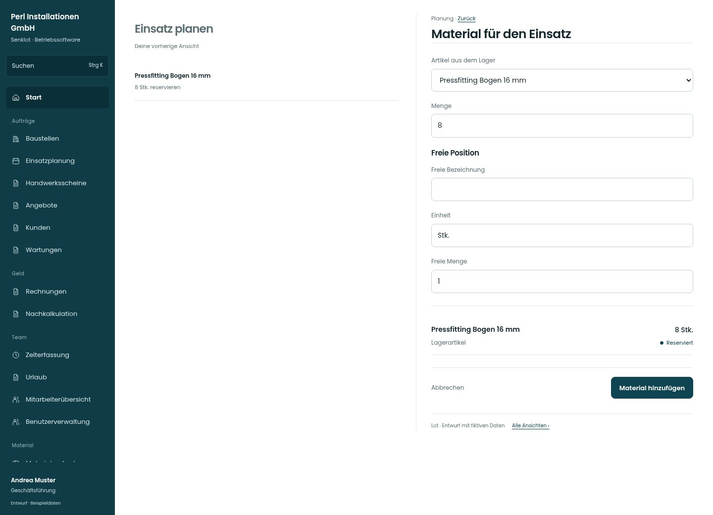

# Material für den Einsatz

[Zur Übersicht](../README.md) · [Bereich: Planung](../bereiche/planung.md)

**Planung · Geschäftsführung · Einsatzfenster · Rüstliste**

Gestaltungsentwurf mit fiktiven Beispieldaten. Aktionen und Datenänderungen sind lokal simuliert, ohne Backend.

[Desktop](../bilder/044-ruestliste-planen-desktop.jpg) · [Tablet](../bilder/044-ruestliste-planen-tablet.jpg) · [Mobil](../bilder/044-ruestliste-planen-mobil.jpg)

## Aufbau

Lagerartikel und freie Position getrennt eingeben können; Rüstliste und tatsächliche Lagerbuchung nicht gleichsetzen.

## Vorhandene Funktionen für die spätere Umsetzung erhalten

- Lagerreservierung und freie Zeilen getrennt
- Mengenprüfung
- Rüstliste bucht keinen Lagerbestand; Anforderung und Abholung bleiben eigene Vorgänge

## Felder im Beispiel

- Artikel aus dem Lager
- Menge
- Freie Bezeichnung
- Einheit
- Freie Menge

## Aktionen

- Material hinzufügen

## Quellen

Quellstand: `3e49090`.
- [src/features/assignments/RuestlistePlanen.tsx](https://github.com/juliandeutsch22/Prototype-App-Installateure/blob/3e49090d4054ebbd3ecbce6ab583bb944c2c0770/src/features/assignments/RuestlistePlanen.tsx)

Die Screens zeigen die vorgesehenen Bedienwege. Reale Speicherung, vollständige Rollenprüfung, Berechnungen, Exporte, Benachrichtigungen und Integrationen müssen bei einer Umsetzung gegen die App geprüft werden.
