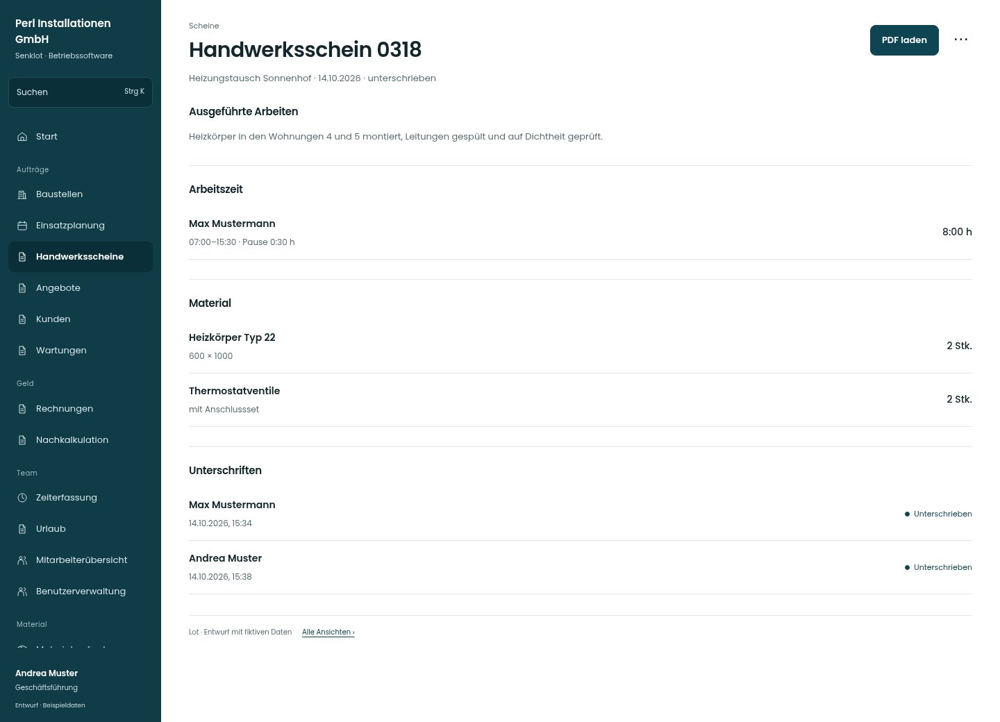

# Handwerksschein 0318

[Zur Übersicht](../README.md) · [Bereich: Scheine](../bereiche/scheine.md)

**Scheine · Geschäftsführung · /worksheets · Einzelheiten**

Gestaltungsentwurf mit fiktiven Beispieldaten. Aktionen und Datenänderungen sind lokal simuliert, ohne Backend.

[Desktop](../bilder/050-schein-detail-desktop.jpg) · [Tablet](../bilder/050-schein-detail-tablet.jpg) · [Mobil](../bilder/050-schein-detail-mobil.jpg)

## Aufbau

PDF sichtbar anbieten und die bestätigten Arbeitszeiten, Materialien und Unterschriften sachlich gliedern; keine nachträgliche Bearbeitung suggerieren.

## Vorhandene Funktionen für die spätere Umsetzung erhalten

- Unterschriebene Scheine unveränderbar
- PDF mit vollständigen Nachweisen
- Abrechnung nur mit Rechnungsrecht

## Aktionen

- PDF laden
- Zur Baustelle

## Quellen

Quellstand: `3e49090`.
- [src/features/worksheets/WorkSheetsListView.tsx](https://github.com/juliandeutsch22/Prototype-App-Installateure/blob/3e49090d4054ebbd3ecbce6ab583bb944c2c0770/src/features/worksheets/WorkSheetsListView.tsx)
- [src/features/worksheets/Schrittfolge.tsx](https://github.com/juliandeutsch22/Prototype-App-Installateure/blob/3e49090d4054ebbd3ecbce6ab583bb944c2c0770/src/features/worksheets/Schrittfolge.tsx)

Die Screens zeigen die vorgesehenen Bedienwege. Reale Speicherung, vollständige Rollenprüfung, Berechnungen, Exporte, Benachrichtigungen und Integrationen müssen bei einer Umsetzung gegen die App geprüft werden.
