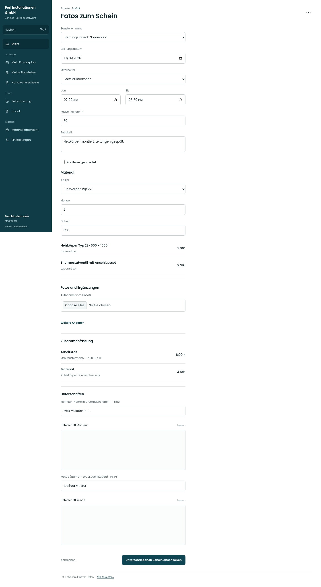

# Fotos zum Schein

[Zur Übersicht](../README.md) · [Bereich: Scheine](../bereiche/scheine.md)

**Scheine · Mitarbeiter · /worksheet · Fotos**

Gestaltungsentwurf mit fiktiven Beispieldaten. Aktionen und Datenänderungen sind lokal simuliert, ohne Backend.

[Desktop](../bilder/053-schein-fotos-desktop.jpg) · [Tablet](../bilder/053-schein-fotos-tablet.jpg) · [Mobil](../bilder/053-schein-fotos-mobil.jpg)

## Aufbau

Kamera/Datei am Fotoabschnitt, Notizen daneben; laufende oder fehlgeschlagene Uploads vor Abschluss erkennbar halten.

## Vorhandene Funktionen für die spätere Umsetzung erhalten

- Kamera und Dateiauswahl
- Bild entfernen
- Upload läuft/Fehler/offline
- Fotos optional nach bestehender Regel

## Register und Filter

- 1 · Zeiten → [schein-zeiten](schein-zeiten.md)
- 2 · Material → [schein-material](schein-material.md)
- 3 · Fotos → [schein-fotos](schein-fotos.md)
- 4 · Unterschrift → [schein-unterschrift](schein-unterschrift.md)

## Felder im Beispiel

- Aufnahme vom Einsatz
- Notizen, Regiearbeiten, Mängel

## Aktionen

- Zur Unterschrift
- Foto aufnehmen

## Quellen

Quellstand: `3e49090`.
- [src/features/worksheets/WorkSheetView.tsx](https://github.com/juliandeutsch22/Prototype-App-Installateure/blob/3e49090d4054ebbd3ecbce6ab583bb944c2c0770/src/features/worksheets/WorkSheetView.tsx)
- [src/features/worksheets/Fotostreifen.tsx](https://github.com/juliandeutsch22/Prototype-App-Installateure/blob/3e49090d4054ebbd3ecbce6ab583bb944c2c0770/src/features/worksheets/Fotostreifen.tsx)

Die Screens zeigen die vorgesehenen Bedienwege. Reale Speicherung, vollständige Rollenprüfung, Berechnungen, Exporte, Benachrichtigungen und Integrationen müssen bei einer Umsetzung gegen die App geprüft werden.
