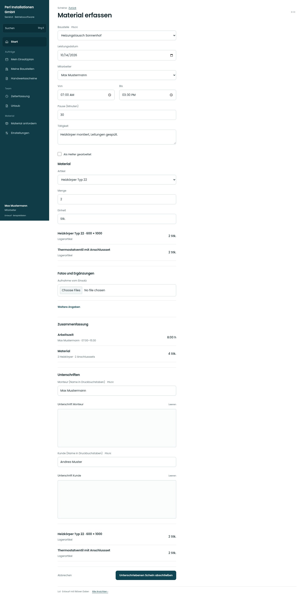

# Material erfassen

[Zur Übersicht](../README.md) · [Bereich: Scheine](../bereiche/scheine.md)

**Scheine · Mitarbeiter · /worksheet · Material**

Gestaltungsentwurf mit fiktiven Beispieldaten. Aktionen und Datenänderungen sind lokal simuliert, ohne Backend.

[Desktop](../bilder/052-schein-material-desktop.jpg) · [Tablet](../bilder/052-schein-material-tablet.jpg) · [Mobil](../bilder/052-schein-material-mobil.jpg)

## Aufbau

Materialpositionen mit Menge und Einheit direkt erfassen; freie Zeile und Lagerartikel bleiben unterscheidbar, Eingaben bleiben beim Schrittwechsel.

## Vorhandene Funktionen für die spätere Umsetzung erhalten

- Lagerartikel/freie Zeilen
- Bestand/Reservierung
- Einheiten und Nachkommastellen

## Register und Filter

- 1 · Zeiten → [schein-zeiten](schein-zeiten.md)
- 2 · Material → [schein-material](schein-material.md)
- 3 · Fotos → [schein-fotos](schein-fotos.md)
- 4 · Unterschrift → [schein-unterschrift](schein-unterschrift.md)

## Felder im Beispiel

- Artikel
- Menge
- Einheit

## Aktionen

- Weiter zu Fotos
- Material hinzufügen

## Quellen

Quellstand: `3e49090`.
- [src/features/worksheets/MaterialErfassen.tsx](https://github.com/juliandeutsch22/Prototype-App-Installateure/blob/3e49090d4054ebbd3ecbce6ab583bb944c2c0770/src/features/worksheets/MaterialErfassen.tsx)
- [src/features/worksheets/WorkSheetView.tsx](https://github.com/juliandeutsch22/Prototype-App-Installateure/blob/3e49090d4054ebbd3ecbce6ab583bb944c2c0770/src/features/worksheets/WorkSheetView.tsx)

Die Screens zeigen die vorgesehenen Bedienwege. Reale Speicherung, vollständige Rollenprüfung, Berechnungen, Exporte, Benachrichtigungen und Integrationen müssen bei einer Umsetzung gegen die App geprüft werden.
