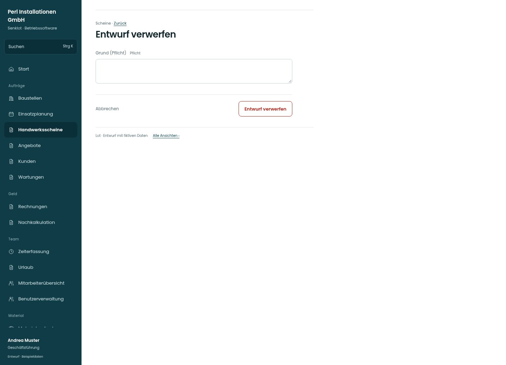

# Entwurf verwerfen

[Zur Übersicht](../README.md) · [Bereich: Scheine](../bereiche/scheine.md)

**Scheine · Geschäftsführung · /worksheets · Verwerfen**

Gestaltungsentwurf mit fiktiven Beispieldaten. Aktionen und Datenänderungen sind lokal simuliert, ohne Backend.

[Desktop](../bilder/055-schein-verwerfen-desktop.jpg) · [Tablet](../bilder/055-schein-verwerfen-tablet.jpg) · [Mobil](../bilder/055-schein-verwerfen-mobil.jpg)

## Aufbau

Pflichtgrund und konkrete Wirkung genügen; unterschriebene Leistung wird nicht als löschbarer Entwurf dargestellt.

## Vorhandene Funktionen für die spätere Umsetzung erhalten

- Pflichtgrund
- Kein Löschen unterschriebener Leistung
- Verworfene weiterhin auffindbar

## Felder im Beispiel

- Grund (Pflicht) (Pflichtfeld)

## Aktionen

- Entwurf verwerfen

## Quellen

Quellstand: `3e49090`.
- [src/features/worksheets/WorkSheetsListView.tsx](https://github.com/juliandeutsch22/Prototype-App-Installateure/blob/3e49090d4054ebbd3ecbce6ab583bb944c2c0770/src/features/worksheets/WorkSheetsListView.tsx)

Die Screens zeigen die vorgesehenen Bedienwege. Reale Speicherung, vollständige Rollenprüfung, Berechnungen, Exporte, Benachrichtigungen und Integrationen müssen bei einer Umsetzung gegen die App geprüft werden.
