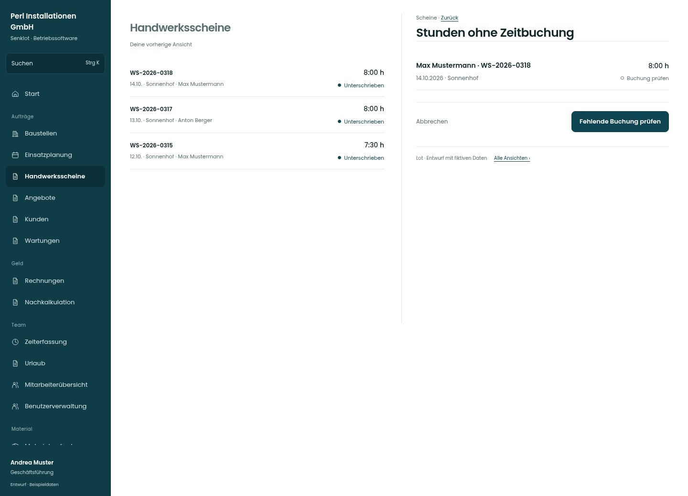

# Stunden ohne Zeitbuchung

[Zur Übersicht](../README.md) · [Bereich: Scheine](../bereiche/scheine.md)

**Scheine · Geschäftsführung · /worksheets · Zeitnachtrag**

Gestaltungsentwurf mit fiktiven Beispieldaten. Aktionen und Datenänderungen sind lokal simuliert, ohne Backend.

[Desktop](../bilder/056-schein-zeit-nachtragen-desktop.jpg) · [Tablet](../bilder/056-schein-zeit-nachtragen-tablet.jpg) · [Mobil](../bilder/056-schein-zeit-nachtragen-mobil.jpg)

## Aufbau

Scheinleistung und tatsächliches Zeitkonto getrennt prüfen; vorhandene Buchung vor Nachtrag nachsehen.

## Vorhandene Funktionen für die spätere Umsetzung erhalten

- Scheinleistung und Zeitkonto getrennt
- Vor Nachtrag auf vorhandene Buchungen prüfen

## Aktionen

- Fehlende Buchung prüfen

## Quellen

Quellstand: `3e49090`.
- [src/features/worksheets/WorkSheetsListView.tsx](https://github.com/juliandeutsch22/Prototype-App-Installateure/blob/3e49090d4054ebbd3ecbce6ab583bb944c2c0770/src/features/worksheets/WorkSheetsListView.tsx)
- [src/features/worksheets/fehlendeZeitbuchung.ts](https://github.com/juliandeutsch22/Prototype-App-Installateure/blob/3e49090d4054ebbd3ecbce6ab583bb944c2c0770/src/features/worksheets/fehlendeZeitbuchung.ts)

Die Screens zeigen die vorgesehenen Bedienwege. Reale Speicherung, vollständige Rollenprüfung, Berechnungen, Exporte, Benachrichtigungen und Integrationen müssen bei einer Umsetzung gegen die App geprüft werden.
