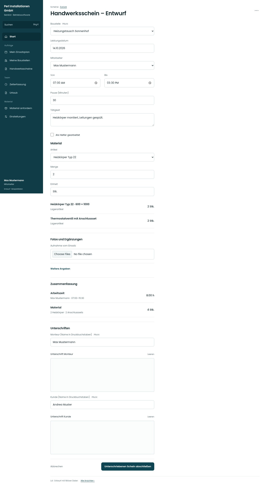

# Handwerksschein – Entwurf

[Zur Übersicht](../README.md) · [Bereich: Scheine](../bereiche/scheine.md)

**Scheine · Mitarbeiter · /worksheet · Zeiten**

Gestaltungsentwurf mit fiktiven Beispieldaten. Aktionen und Datenänderungen sind lokal simuliert, ohne Backend.

[Desktop](../bilder/051-schein-zeiten-desktop.jpg) · [Tablet](../bilder/051-schein-zeiten-tablet.jpg) · [Mobil](../bilder/051-schein-zeiten-mobil.jpg)

## Aufbau

Mehrere Zeiten direkt ergänzen, Schrittstand erhalten; Desktop als vollständiger Arbeitsbogen, Mobil als klarer Schrittfluss.

## Vorhandene Funktionen für die spätere Umsetzung erhalten

- Entwurf bleibt beim Schrittwechsel erhalten
- Mehrere Leistungszeiten
- Kein doppeltes Buchen ins Zeitkonto

## Register und Filter

- 1 · Zeiten → [schein-zeiten](schein-zeiten.md)
- 2 · Material → [schein-material](schein-material.md)
- 3 · Fotos → [schein-fotos](schein-fotos.md)
- 4 · Unterschrift → [schein-unterschrift](schein-unterschrift.md)

## Felder im Beispiel

- Baustelle (Pflichtfeld)
- Leistungsdatum
- Mitarbeiter
- Von
- Bis
- Pause (Minuten)
- Tätigkeit
- Als Helfer gearbeitet

## Aktionen

- Weiter zu Material
- Zeile hinzufügen

## Quellen

Quellstand: `3e49090`.
- [src/features/worksheets/WorkSheetView.tsx](https://github.com/juliandeutsch22/Prototype-App-Installateure/blob/3e49090d4054ebbd3ecbce6ab583bb944c2c0770/src/features/worksheets/WorkSheetView.tsx)
- [src/features/worksheets/LeistungszeitErfassen.tsx](https://github.com/juliandeutsch22/Prototype-App-Installateure/blob/3e49090d4054ebbd3ecbce6ab583bb944c2c0770/src/features/worksheets/LeistungszeitErfassen.tsx)
- [src/features/worksheets/Schrittfolge.tsx](https://github.com/juliandeutsch22/Prototype-App-Installateure/blob/3e49090d4054ebbd3ecbce6ab583bb944c2c0770/src/features/worksheets/Schrittfolge.tsx)

Die Screens zeigen die vorgesehenen Bedienwege. Reale Speicherung, vollständige Rollenprüfung, Berechnungen, Exporte, Benachrichtigungen und Integrationen müssen bei einer Umsetzung gegen die App geprüft werden.
