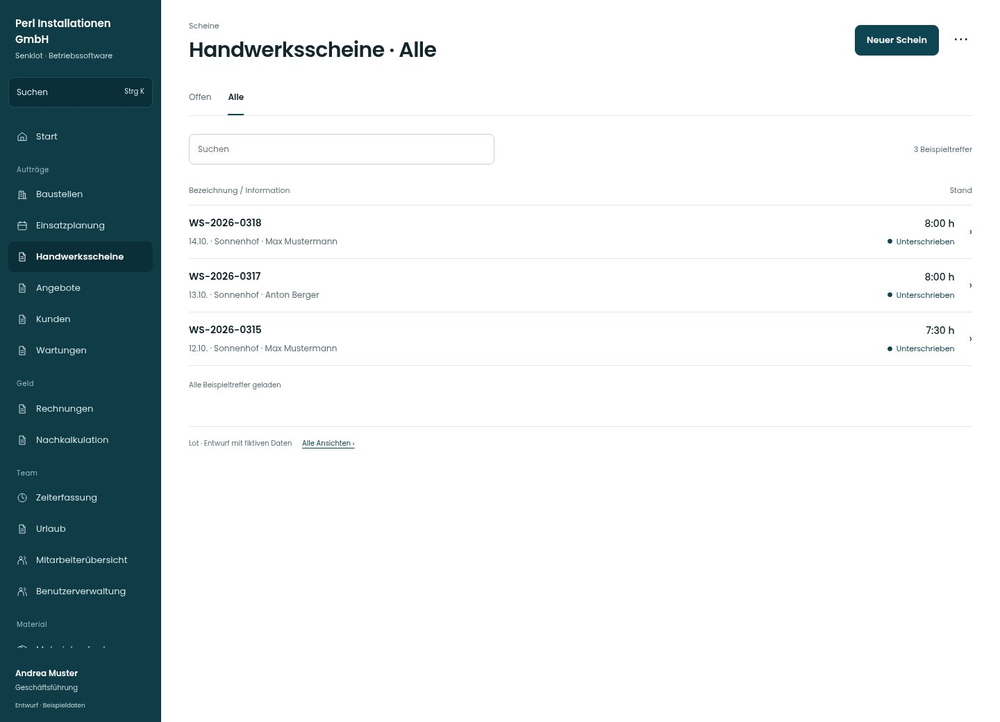

# Handwerksscheine · Alle

[Zur Übersicht](../README.md) · [Bereich: Scheine](../bereiche/scheine.md)

**Scheine · Geschäftsführung · /worksheets**

Gestaltungsentwurf mit fiktiven Beispieldaten. Aktionen und Datenänderungen sind lokal simuliert, ohne Backend.

[Desktop](../bilder/224-scheine-filter-1-desktop.jpg) · [Tablet](../bilder/224-scheine-filter-1-tablet.jpg) · [Mobil](../bilder/224-scheine-filter-1-mobil.jpg)

## Aufbau

Arbeitsstände und Datum/Person tragen die Liste; Entwürfe weiterführen und unterschriebene Leistung schreibgeschützt prüfen.

## Vorhandene Funktionen für die spätere Umsetzung erhalten

- Schreibrolle getrennt von Leserechten
- Entwurf weiterbearbeiten
- PDF
- Verwerfen mit Pflichtgrund
- Zeitnachtrag

## Register und Filter

- Offen → [scheine](scheine.md)
- Alle → [scheine-filter-1](scheine-filter-1.md)

## Aktionen

- Neuer Schein
- Stunden ohne Buchung prüfen

## Quellen

Quellstand: `3e49090`.
- [src/features/worksheets/WorkSheetsListView.tsx](https://github.com/juliandeutsch22/Prototype-App-Installateure/blob/3e49090d4054ebbd3ecbce6ab583bb944c2c0770/src/features/worksheets/WorkSheetsListView.tsx)

Die Screens zeigen die vorgesehenen Bedienwege. Reale Speicherung, vollständige Rollenprüfung, Berechnungen, Exporte, Benachrichtigungen und Integrationen müssen bei einer Umsetzung gegen die App geprüft werden.
