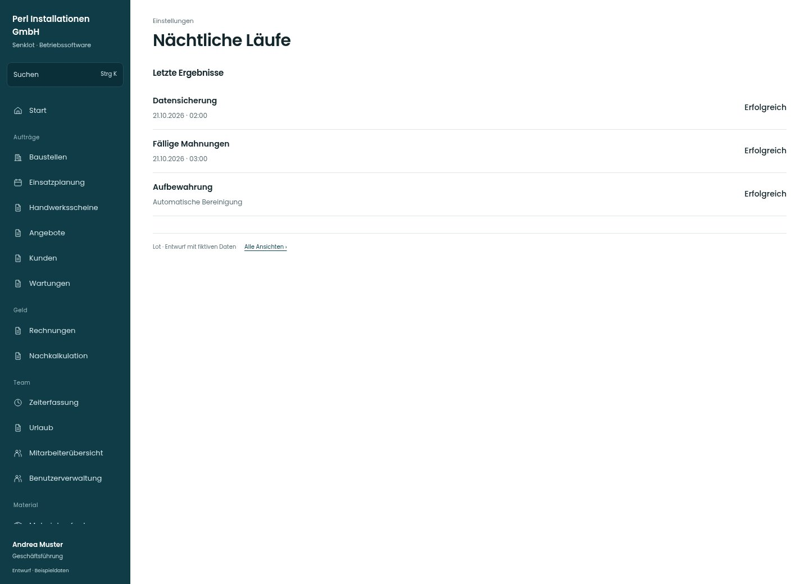

# Nächtliche Läufe

[Zur Übersicht](../README.md) · [Bereich: Einstellungen](../bereiche/einstellungen.md)

**Einstellungen · Geschäftsführung · /settings/sicherung**

Gestaltungsentwurf mit fiktiven Beispieldaten. Aktionen und Datenänderungen sind lokal simuliert, ohne Backend.

[Desktop](../bilder/250-sicherung-lauf-desktop.jpg) · [Tablet](../bilder/250-sicherung-lauf-tablet.jpg) · [Mobil](../bilder/250-sicherung-lauf-mobil.jpg)

## Aufbau

Letzten Lauf und belegtes externes Ziel getrennt ausweisen; unbekannte Sicherungsbestandteile nicht als erfolgreich darstellen.

## Vorhandene Funktionen für die spätere Umsetzung erhalten

- Erfolg/unbekannt/überfällig unterscheiden
- Externes Ziel nicht aus erfolgreichem Lauf ableiten
- Fotos/Dateien separat nachweisen
- Kein Restore-Knopf ohne bestehende Funktion
- Exportgrenzen und Teilfehler

## Quellen

Quellstand: `3e49090`.
- [src/features/settings/LaufStatus.tsx](https://github.com/juliandeutsch22/Prototype-App-Installateure/blob/3e49090d4054ebbd3ecbce6ab583bb944c2c0770/src/features/settings/LaufStatus.tsx)

Die Screens zeigen die vorgesehenen Bedienwege. Reale Speicherung, vollständige Rollenprüfung, Berechnungen, Exporte, Benachrichtigungen und Integrationen müssen bei einer Umsetzung gegen die App geprüft werden.
