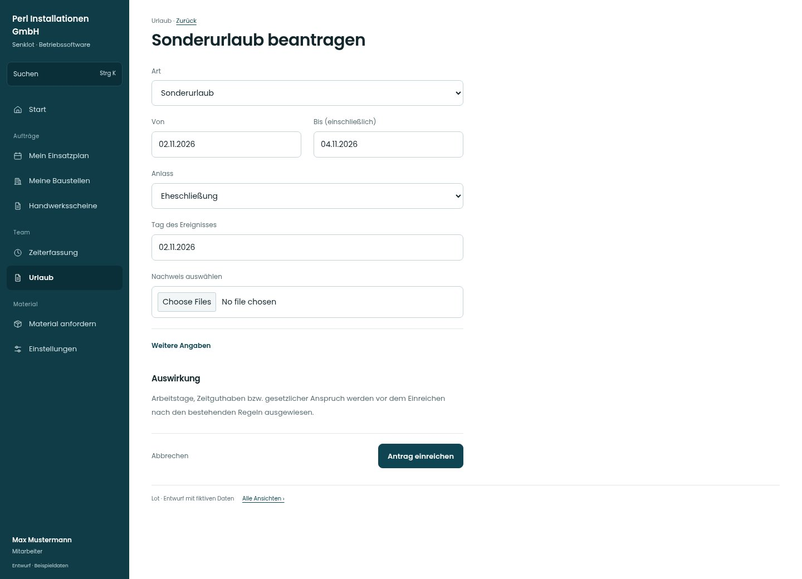

# Sonderurlaub beantragen

[Zur Übersicht](../README.md) · [Bereich: Urlaub](../bereiche/urlaub.md)

**Urlaub · Mitarbeiter · /vacations · Sonderurlaub**

Gestaltungsentwurf mit fiktiven Beispieldaten. Aktionen und Datenänderungen sind lokal simuliert, ohne Backend.

[Desktop](../bilder/108-sonderurlaub-desktop.jpg) · [Tablet](../bilder/108-sonderurlaub-tablet.jpg) · [Mobil](../bilder/108-sonderurlaub-mobil.jpg)

## Aufbau

Anlass, Ereignis und Nachweis zusammenhalten; der bestehende Anspruch wird bestätigt statt als beliebiges Ermessen dargestellt.

## Vorhandene Funktionen für die spätere Umsetzung erhalten

- Überschneidungen prüfen
- Teilzeit/halbe Tage
- Resturlaub im richtigen Urlaubsjahr
- Unbezahlter Urlaub nur Spitze entscheidet
- Sonderurlaub bestätigen statt Ermessensurlaub

## Felder im Beispiel

- Art
- Von
- Bis (einschließlich)
- Anlass
- Tag des Ereignisses
- Nachweis auswählen
- Anmerkung

## Aktionen

- Antrag einreichen

## Quellen

Quellstand: `3e49090`.
- [src/features/vacations/VacationsView.tsx](https://github.com/juliandeutsch22/Prototype-App-Installateure/blob/3e49090d4054ebbd3ecbce6ab583bb944c2c0770/src/features/vacations/VacationsView.tsx)
- [src/features/vacations/FreistellungFormular.tsx](https://github.com/juliandeutsch22/Prototype-App-Installateure/blob/3e49090d4054ebbd3ecbce6ab583bb944c2c0770/src/features/vacations/FreistellungFormular.tsx)

Die Screens zeigen die vorgesehenen Bedienwege. Reale Speicherung, vollständige Rollenprüfung, Berechnungen, Exporte, Benachrichtigungen und Integrationen müssen bei einer Umsetzung gegen die App geprüft werden.
