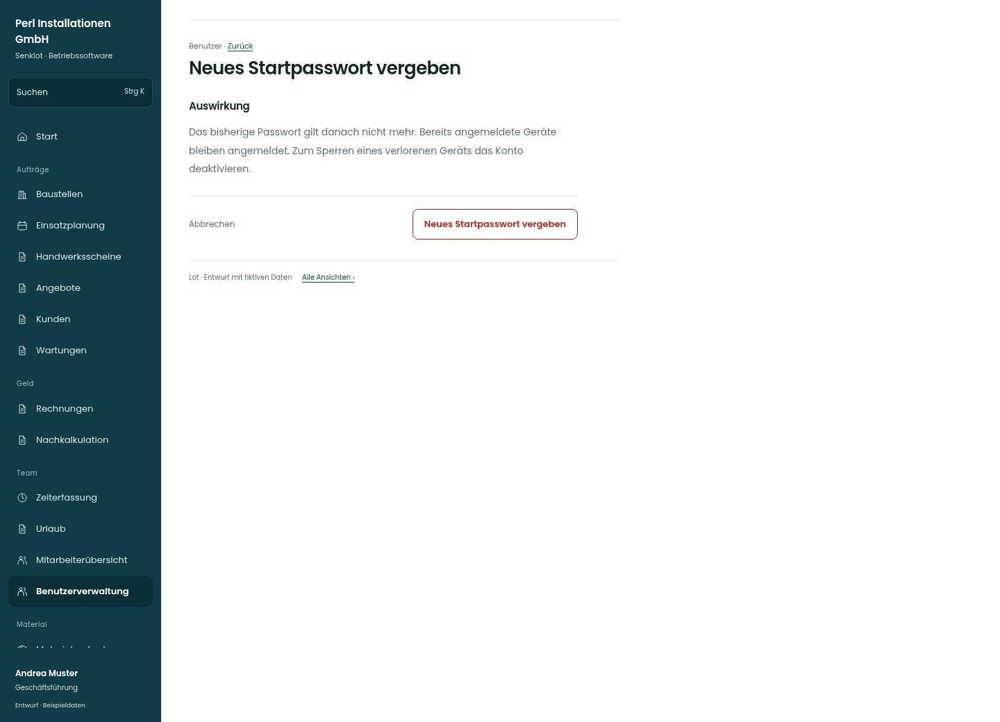

# Neues Startpasswort vergeben

[Zur Übersicht](../README.md) · [Bereich: Benutzer](../bereiche/benutzer.md)

**Benutzer · Geschäftsführung · /user-mgmt/:uid · Startpasswort**

Gestaltungsentwurf mit fiktiven Beispieldaten. Aktionen und Datenänderungen sind lokal simuliert, ohne Backend.

[Desktop](../bilder/131-startpasswort-desktop.jpg) · [Tablet](../bilder/131-startpasswort-tablet.jpg) · [Mobil](../bilder/131-startpasswort-mobil.jpg)

## Aufbau

Wirkung auf Passwort und bereits angemeldete Geräte präzise vor Bestätigung zeigen; keine echten Zugangsdaten im Konzept erzeugen.

## Vorhandene Funktionen für die spätere Umsetzung erhalten

- Bestätigung
- Kennwort nur einmal zeigen und nicht loggen
- Kein echter Zugang im Konzept

## Aktionen

- Neues Startpasswort vergeben

## Quellen

Quellstand: `3e49090`.
- [src/features/users/BenutzerakteView.tsx](https://github.com/juliandeutsch22/Prototype-App-Installateure/blob/3e49090d4054ebbd3ecbce6ab583bb944c2c0770/src/features/users/BenutzerakteView.tsx)

Die Screens zeigen die vorgesehenen Bedienwege. Reale Speicherung, vollständige Rollenprüfung, Berechnungen, Exporte, Benachrichtigungen und Integrationen müssen bei einer Umsetzung gegen die App geprüft werden.
