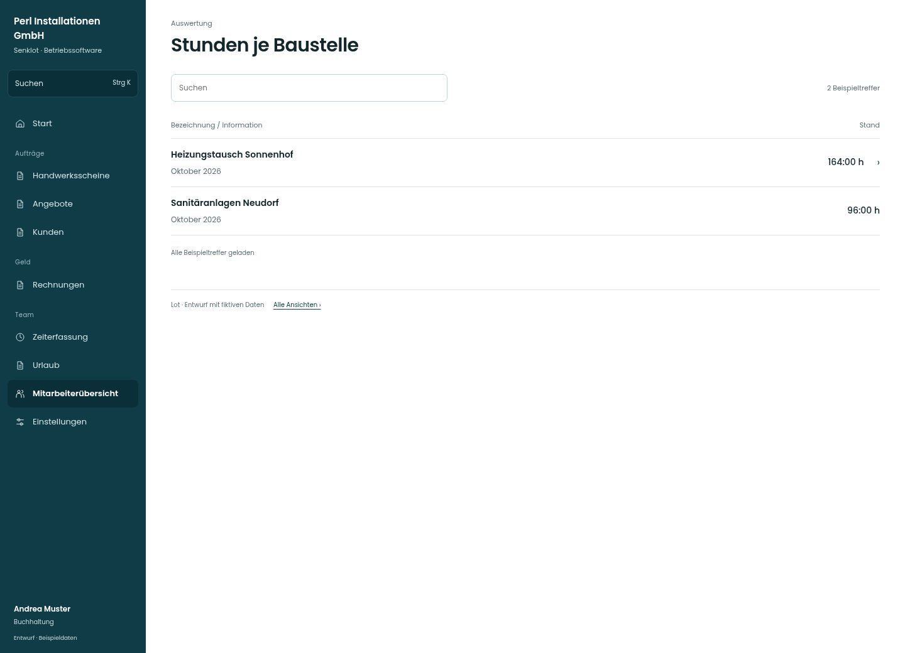

# Stunden je Baustelle

[Zur Übersicht](../README.md) · [Bereich: Auswertung](../bereiche/auswertung.md)

**Auswertung · Buchhaltung · /accounting · Baustellenauswertung**

Gestaltungsentwurf mit fiktiven Beispieldaten. Aktionen und Datenänderungen sind lokal simuliert, ohne Backend.

[Desktop](../bilder/123-stunden-baustellen-desktop.jpg) · [Tablet](../bilder/123-stunden-baustellen-tablet.jpg) · [Mobil](../bilder/123-stunden-baustellen-mobil.jpg)

## Aufbau

Stunden je Baustelle im gewählten Zeitraum vergleichen; keine internen Kosten oder Margen in diese Übersicht mischen.

## Vorhandene Funktionen für die spätere Umsetzung erhalten

- Gewählter Zeitraum
- Gesamtstunden aller berechtigten Buchungen
- Keine Margen offenlegen

## Quellen

Quellstand: `3e49090`.
- [src/features/accounting/ProjectSummary.tsx](https://github.com/juliandeutsch22/Prototype-App-Installateure/blob/3e49090d4054ebbd3ecbce6ab583bb944c2c0770/src/features/accounting/ProjectSummary.tsx)

Die Screens zeigen die vorgesehenen Bedienwege. Reale Speicherung, vollständige Rollenprüfung, Berechnungen, Exporte, Benachrichtigungen und Integrationen müssen bei einer Umsetzung gegen die App geprüft werden.
