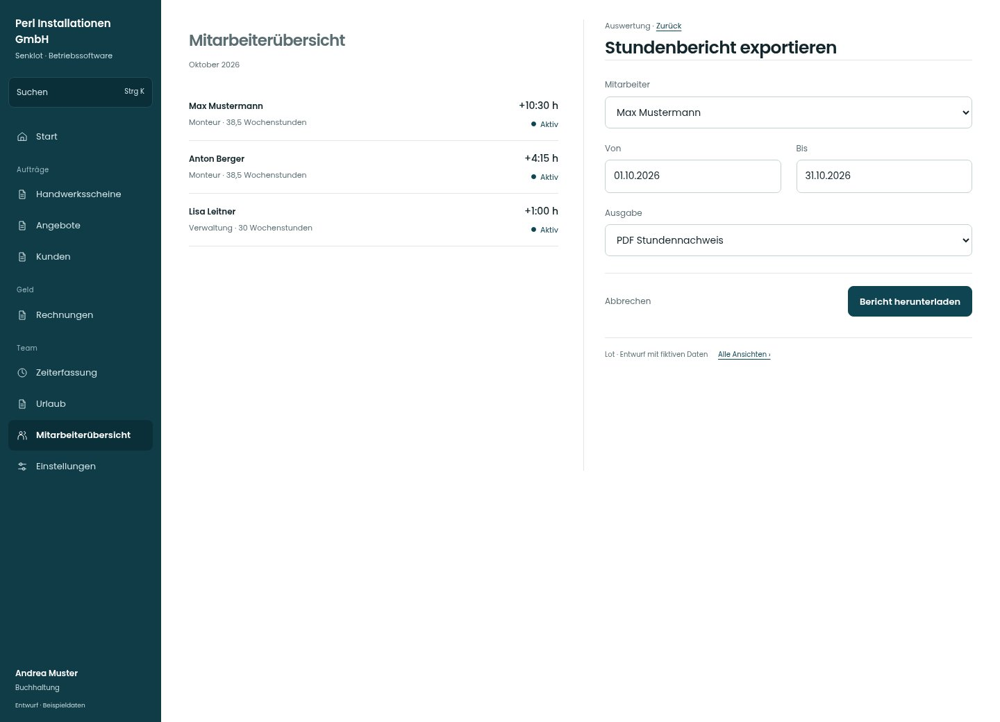

# Stundenbericht exportieren

[Zur Übersicht](../README.md) · [Bereich: Auswertung](../bereiche/auswertung.md)

**Auswertung · Buchhaltung · /accounting · Export**

Gestaltungsentwurf mit fiktiven Beispieldaten. Aktionen und Datenänderungen sind lokal simuliert, ohne Backend.

[Desktop](../bilder/122-stunden-export-desktop.jpg) · [Tablet](../bilder/122-stunden-export-tablet.jpg) · [Mobil](../bilder/122-stunden-export-mobil.jpg)

## Aufbau

Person, Zeitraum und vorhandenes Ausgabeformat genügen; keine neue Berechnung oder unbeabsichtigte Einschränkung des Berichts.

## Vorhandene Funktionen für die spätere Umsetzung erhalten

- Bestehende PDF-/CSV-Berechnungen
- Zeitraum und Person
- Personen ohne Zeitkonto korrekt behandeln

## Felder im Beispiel

- Mitarbeiter
- Von
- Bis
- Ausgabe

## Aktionen

- Bericht herunterladen

## Quellen

Quellstand: `3e49090`.
- [src/features/accounting/ExportDialog.tsx](https://github.com/juliandeutsch22/Prototype-App-Installateure/blob/3e49090d4054ebbd3ecbce6ab583bb944c2c0770/src/features/accounting/ExportDialog.tsx)

Die Screens zeigen die vorgesehenen Bedienwege. Reale Speicherung, vollständige Rollenprüfung, Berechnungen, Exporte, Benachrichtigungen und Integrationen müssen bei einer Umsetzung gegen die App geprüft werden.
