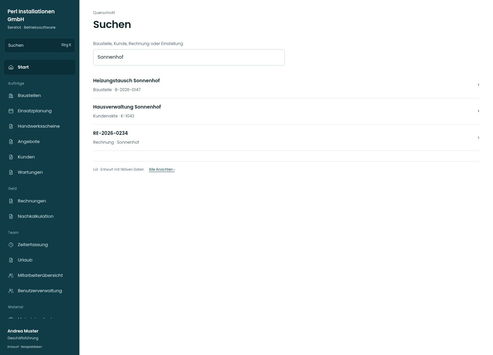

# Suchen

[Zur Übersicht](../README.md) · [Bereich: Querschnitt](../bereiche/querschnitt.md)

**Querschnitt · Geschäftsführung · Globale Suche**

Gestaltungsentwurf mit fiktiven Beispieldaten. Aktionen und Datenänderungen sind lokal simuliert, ohne Backend.

[Desktop](../bilder/163-suche-desktop.jpg) · [Tablet](../bilder/163-suche-tablet.jpg) · [Mobil](../bilder/163-suche-mobil.jpg)

## Aufbau

Rollen- und modulabhängige Ziele mit Typ und Kontext als Zeilen zeigen; Eingabe durchsucht sichtbar die Treffer.

## Vorhandene Funktionen für die spätere Umsetzung erhalten

- Nur für Rolle und Modul sichtbare Ziele
- Tastatur und Fokus
- Keine gesperrten Seiten als Treffer

## Felder im Beispiel

- Baustelle, Kunde, Rechnung oder Einstellung

## Quellen

Quellstand: `3e49090`.
- [src/app/Suchfenster.tsx](https://github.com/juliandeutsch22/Prototype-App-Installateure/blob/3e49090d4054ebbd3ecbce6ab583bb944c2c0770/src/app/Suchfenster.tsx)

Die Screens zeigen die vorgesehenen Bedienwege. Reale Speicherung, vollständige Rollenprüfung, Berechnungen, Exporte, Benachrichtigungen und Integrationen müssen bei einer Umsetzung gegen die App geprüft werden.
