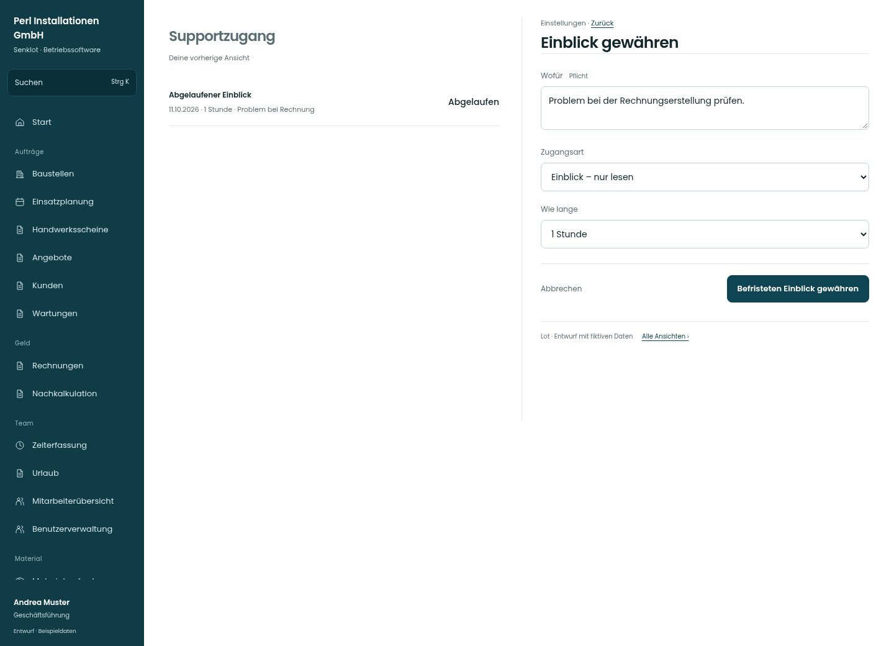

# Einblick gewähren

[Zur Übersicht](../README.md) · [Bereich: Einstellungen](../bereiche/einstellungen.md)

**Einstellungen · Geschäftsführung · /settings/support · Freigabe**

Gestaltungsentwurf mit fiktiven Beispieldaten. Aktionen und Datenänderungen sind lokal simuliert, ohne Backend.

[Desktop](../bilder/151-support-gewaehren-desktop.jpg) · [Tablet](../bilder/151-support-gewaehren-tablet.jpg) · [Mobil](../bilder/151-support-gewaehren-mobil.jpg)

## Aufbau

Zweck, Zugangsart und Dauer zusammen vor Freigabe; Mitarbeit muss ausdrücklich gewählt bleiben.

## Vorhandene Funktionen für die spätere Umsetzung erhalten

- Bewusste Freigabe durch Spitze
- Sichtbarkeit und Widerruf
- Keine dauerhafte Freigabe suggerieren
- Mitarbeiten muss ausdrücklich gewählt werden
- Zeitbuchungen, Urlaub, Krankenstände und Baustellenfotos bleiben ausgenommen wie im Bestand

## Felder im Beispiel

- Wofür (Pflichtfeld)
- Zugangsart
- Wie lange

## Aktionen

- Befristeten Einblick gewähren

## Quellen

Quellstand: `3e49090`.
- [src/features/settings/SupportzugangView.tsx](https://github.com/juliandeutsch22/Prototype-App-Installateure/blob/3e49090d4054ebbd3ecbce6ab583bb944c2c0770/src/features/settings/SupportzugangView.tsx)

Die Screens zeigen die vorgesehenen Bedienwege. Reale Speicherung, vollständige Rollenprüfung, Berechnungen, Exporte, Benachrichtigungen und Integrationen müssen bei einer Umsetzung gegen die App geprüft werden.
