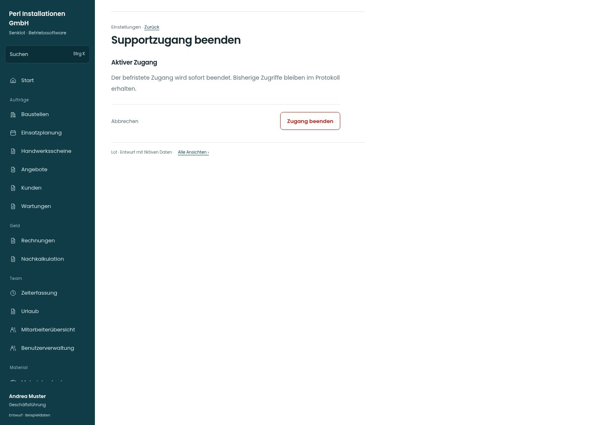

# Supportzugang beenden

[Zur Übersicht](../README.md) · [Bereich: Einstellungen](../bereiche/einstellungen.md)

**Einstellungen · Geschäftsführung · /settings/support · Supportzugang beenden**

Gestaltungsentwurf mit fiktiven Beispieldaten. Aktionen und Datenänderungen sind lokal simuliert, ohne Backend.

[Desktop](../bilder/199-support-widerrufen-desktop.jpg) · [Tablet](../bilder/199-support-widerrufen-tablet.jpg) · [Mobil](../bilder/199-support-widerrufen-mobil.jpg)

## Aufbau

Konkrete aktive Freigabe beenden und Protokoll erhalten; nur bei offenem Zugang anbieten.

## Vorhandene Funktionen für die spätere Umsetzung erhalten

- Nur bei tatsächlich offenem Zugang anbieten
- Bestehender Widerruf und Protokoll bleiben

## Aktionen

- Zugang beenden

## Quellen

Quellstand: `3e49090`.
- [src/features/settings/SupportzugangView.tsx](https://github.com/juliandeutsch22/Prototype-App-Installateure/blob/3e49090d4054ebbd3ecbce6ab583bb944c2c0770/src/features/settings/SupportzugangView.tsx)

Die Screens zeigen die vorgesehenen Bedienwege. Reale Speicherung, vollständige Rollenprüfung, Berechnungen, Exporte, Benachrichtigungen und Integrationen müssen bei einer Umsetzung gegen die App geprüft werden.
