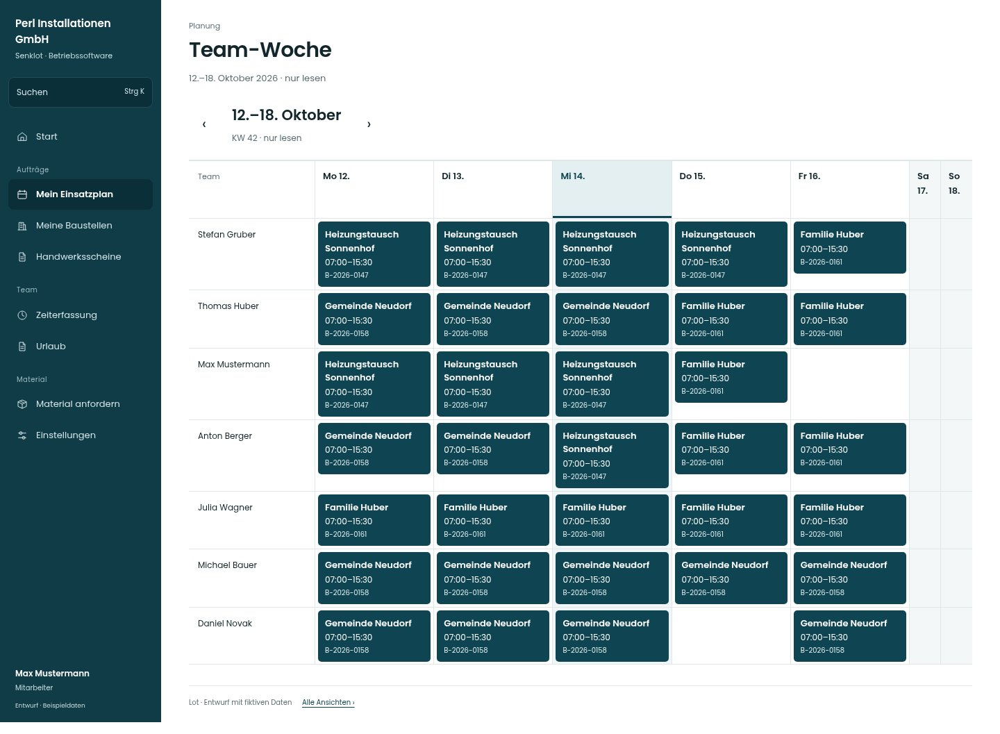

# Team-Woche

[Zur Übersicht](../README.md) · [Bereich: Planung](../bereiche/planung.md)

**Planung · Mitarbeiter · /my-schedule/team**

Gestaltungsentwurf mit fiktiven Beispieldaten. Aktionen und Datenänderungen sind lokal simuliert, ohne Backend.

[Desktop](../bilder/047-team-woche-desktop.jpg) · [Tablet](../bilder/047-team-woche-tablet.jpg) · [Mobil](../bilder/047-team-woche-mobil.jpg)

## Aufbau

Dieselbe visuelle Plansprache nur lesend verwenden; keine freien Kapazitäten, Bearbeitung oder vertraulichen Abwesenheitsgründe offenlegen.

## Vorhandene Funktionen für die spätere Umsetzung erhalten

- Nur bei wochenplanFuerAlle
- Abwesend ohne Grund
- Keine Planungsaktionen
- Datenbank-Sichtbarkeit bleibt gleich

## Quellen

Quellstand: `3e49090`.
- [src/features/assignments/TeamWoche.tsx](https://github.com/juliandeutsch22/Prototype-App-Installateure/blob/3e49090d4054ebbd3ecbce6ab583bb944c2c0770/src/features/assignments/TeamWoche.tsx)
- [src/features/assignments/WochenplanView.tsx](https://github.com/juliandeutsch22/Prototype-App-Installateure/blob/3e49090d4054ebbd3ecbce6ab583bb944c2c0770/src/features/assignments/WochenplanView.tsx)

Die Screens zeigen die vorgesehenen Bedienwege. Reale Speicherung, vollständige Rollenprüfung, Berechnungen, Exporte, Benachrichtigungen und Integrationen müssen bei einer Umsetzung gegen die App geprüft werden.
