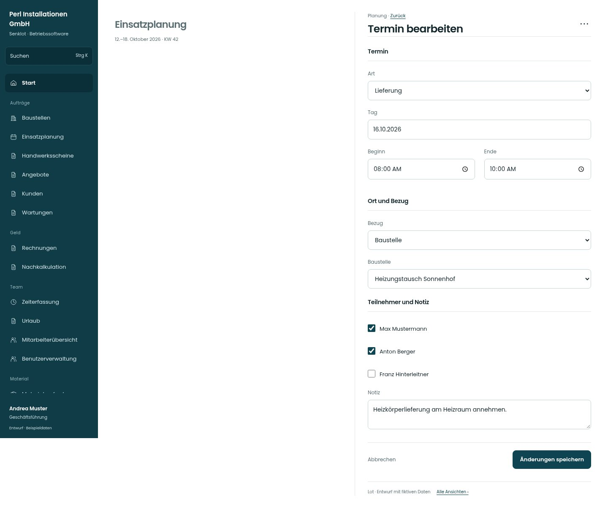

# Termin bearbeiten

[Zur Übersicht](../README.md) · [Bereich: Planung](../bereiche/planung.md)

**Planung · Geschäftsführung · Terminfenster**

Gestaltungsentwurf mit fiktiven Beispieldaten. Aktionen und Datenänderungen sind lokal simuliert, ohne Backend.

[Desktop](../bilder/258-termin-bearbeiten-desktop.jpg) · [Tablet](../bilder/258-termin-bearbeiten-tablet.jpg) · [Mobil](../bilder/258-termin-bearbeiten-mobil.jpg)

## Aufbau

Teilnehmerauswahl ergänzen und Baustellen-/Kundenbezug alternativ zeigen; beide Bezüge gleichzeitig als Pflichtfelder wären irreführend.

## Vorhandene Funktionen für die spätere Umsetzung erhalten

- Baustellen- oder Kundenbezug
- Teilnehmerauswahl
- Lieferzeitfenster
- Schreibrecht und Validierung aus TerminFormular.tsx

## Felder im Beispiel

- Art
- Tag
- Beginn
- Ende
- Bezug
- Baustelle
- Kunde
- Max Mustermann
- Anton Berger
- Franz Hinterleitner
- Notiz

## Aktionen

- Änderungen speichern
- Termin löschen

## Quellen

Quellstand: `3e49090`.
- [src/features/termine/TerminFenster.tsx](https://github.com/juliandeutsch22/Prototype-App-Installateure/blob/3e49090d4054ebbd3ecbce6ab583bb944c2c0770/src/features/termine/TerminFenster.tsx)
- [src/features/termine/TerminFormular.tsx](https://github.com/juliandeutsch22/Prototype-App-Installateure/blob/3e49090d4054ebbd3ecbce6ab583bb944c2c0770/src/features/termine/TerminFormular.tsx)

Die Screens zeigen die vorgesehenen Bedienwege. Reale Speicherung, vollständige Rollenprüfung, Berechnungen, Exporte, Benachrichtigungen und Integrationen müssen bei einer Umsetzung gegen die App geprüft werden.
