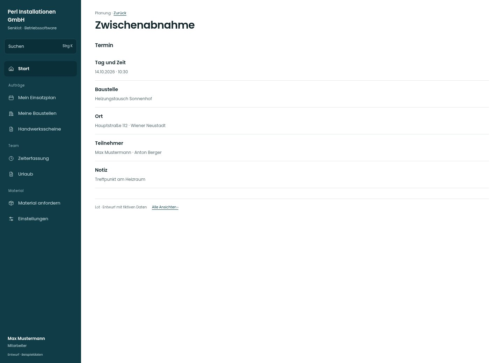

# Zwischenabnahme

[Zur Übersicht](../README.md) · [Bereich: Planung](../bereiche/planung.md)

**Planung · Mitarbeiter · Terminfenster**

Gestaltungsentwurf mit fiktiven Beispieldaten. Aktionen und Datenänderungen sind lokal simuliert, ohne Backend.

[Desktop](../bilder/215-termin-lesen-desktop.jpg) · [Tablet](../bilder/215-termin-lesen-tablet.jpg) · [Mobil](../bilder/215-termin-lesen-mobil.jpg)

## Aufbau

Bedingten Arbeitszustand bzw. getrennte Aufgabe explizit zeigen, ohne vorhandene Ansicht umzudeuten.

## Vorhandene Funktionen für die spätere Umsetzung erhalten

- Baustellen- oder Kundenbezug
- Teilnehmerauswahl
- Lieferzeitfenster
- Schreibrecht und Validierung aus TerminFormular.tsx

## Quellen

Quellstand: `3e49090`.
- [src/features/termine/TerminFenster.tsx](https://github.com/juliandeutsch22/Prototype-App-Installateure/blob/3e49090d4054ebbd3ecbce6ab583bb944c2c0770/src/features/termine/TerminFenster.tsx)
- [src/features/termine/TerminFormular.tsx](https://github.com/juliandeutsch22/Prototype-App-Installateure/blob/3e49090d4054ebbd3ecbce6ab583bb944c2c0770/src/features/termine/TerminFormular.tsx)

Die Screens zeigen die vorgesehenen Bedienwege. Reale Speicherung, vollständige Rollenprüfung, Berechnungen, Exporte, Benachrichtigungen und Integrationen müssen bei einer Umsetzung gegen die App geprüft werden.
