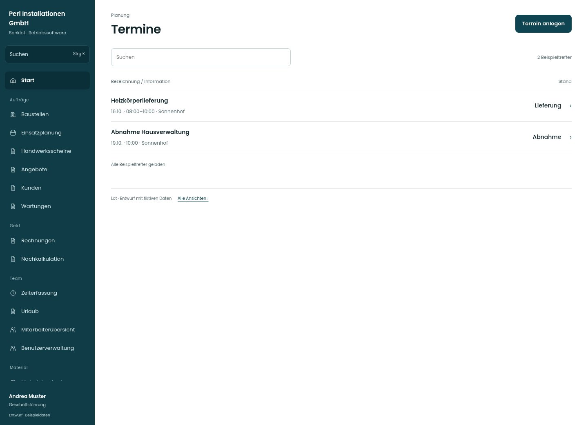

# Termine

[Zur Übersicht](../README.md) · [Bereich: Planung](../bereiche/planung.md)

**Planung · Geschäftsführung · In Baustellen- und Kundenakte**

Gestaltungsentwurf mit fiktiven Beispieldaten. Aktionen und Datenänderungen sind lokal simuliert, ohne Backend.

[Desktop](../bilder/038-termine-desktop.jpg) · [Tablet](../bilder/038-termine-tablet.jpg) · [Mobil](../bilder/038-termine-mobil.jpg)

## Aufbau

Datum, Zeitfenster und Terminart im Text sauber unterscheiden; eine Abnahme nicht als Besichtigung beschriften.

## Vorhandene Funktionen für die spätere Umsetzung erhalten

- Schreibrecht nur Verwaltung/Leitung
- Kunden-/Baustellenbezug
- Terminarten

## Aktionen

- Termin anlegen

## Quellen

Quellstand: `3e49090`.
- [src/features/termine/TermineKarte.tsx](https://github.com/juliandeutsch22/Prototype-App-Installateure/blob/3e49090d4054ebbd3ecbce6ab583bb944c2c0770/src/features/termine/TermineKarte.tsx)
- [src/features/termine/TerminListe.tsx](https://github.com/juliandeutsch22/Prototype-App-Installateure/blob/3e49090d4054ebbd3ecbce6ab583bb944c2c0770/src/features/termine/TerminListe.tsx)

Die Screens zeigen die vorgesehenen Bedienwege. Reale Speicherung, vollständige Rollenprüfung, Berechnungen, Exporte, Benachrichtigungen und Integrationen müssen bei einer Umsetzung gegen die App geprüft werden.
