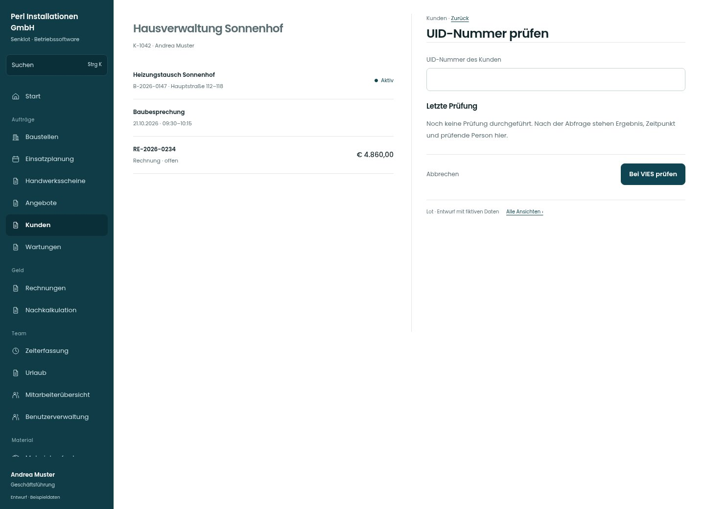

# UID-Nummer prüfen

[Zur Übersicht](../README.md) · [Bereich: Kunden](../bereiche/kunden.md)

**Kunden · Geschäftsführung · /customers/:id · UID-Nummer prüfen**

Gestaltungsentwurf mit fiktiven Beispieldaten. Aktionen und Datenänderungen sind lokal simuliert, ohne Backend.

[Desktop](../bilder/194-uid-pruefung-desktop.jpg) · [Tablet](../bilder/194-uid-pruefung-tablet.jpg) · [Mobil](../bilder/194-uid-pruefung-mobil.jpg)

## Aufbau

Nummer, letzte Prüfung und bewusst ausgelöste Abfrage erhalten; Netzfehler bleiben unbekannt statt ungültig.

## Vorhandene Funktionen für die spätere Umsetzung erhalten

- Nur bestehende Prüfrechte
- Firmen-UID erforderlich
- Keine Echtheitszusage bei Netzfehler
- Prüfergebnis mit Zeit und Person

## Felder im Beispiel

- UID-Nummer des Kunden

## Aktionen

- Bei VIES prüfen

## Quellen

Quellstand: `3e49090`.
- [src/features/customers/UidVies.tsx](https://github.com/juliandeutsch22/Prototype-App-Installateure/blob/3e49090d4054ebbd3ecbce6ab583bb944c2c0770/src/features/customers/UidVies.tsx)

Die Screens zeigen die vorgesehenen Bedienwege. Reale Speicherung, vollständige Rollenprüfung, Berechnungen, Exporte, Benachrichtigungen und Integrationen müssen bei einer Umsetzung gegen die App geprüft werden.
