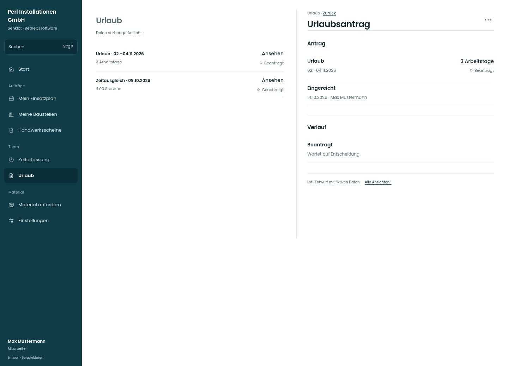

# Urlaubsantrag

[Zur Übersicht](../README.md) · [Bereich: Urlaub](../bereiche/urlaub.md)

**Urlaub · Mitarbeiter · /vacations · Antrag**

Gestaltungsentwurf mit fiktiven Beispieldaten. Aktionen und Datenänderungen sind lokal simuliert, ohne Backend.

[Desktop](../bilder/111-urlaub-detail-desktop.jpg) · [Tablet](../bilder/111-urlaub-detail-tablet.jpg) · [Mobil](../bilder/111-urlaub-detail-mobil.jpg)

## Aufbau

Antrag und Verlauf lesbar erhalten; Zurückziehen nur beim erlaubten offenen Zustand anbieten.

## Vorhandene Funktionen für die spätere Umsetzung erhalten

- Zurückziehen nur erlaubt/offen
- Genehmigter Urlaub nur nach Rechten ändern

## Aktionen

- Antrag zurückziehen

## Quellen

Quellstand: `3e49090`.
- [src/features/vacations/AntragFenster.tsx](https://github.com/juliandeutsch22/Prototype-App-Installateure/blob/3e49090d4054ebbd3ecbce6ab583bb944c2c0770/src/features/vacations/AntragFenster.tsx)

Die Screens zeigen die vorgesehenen Bedienwege. Reale Speicherung, vollständige Rollenprüfung, Berechnungen, Exporte, Benachrichtigungen und Integrationen müssen bei einer Umsetzung gegen die App geprüft werden.
