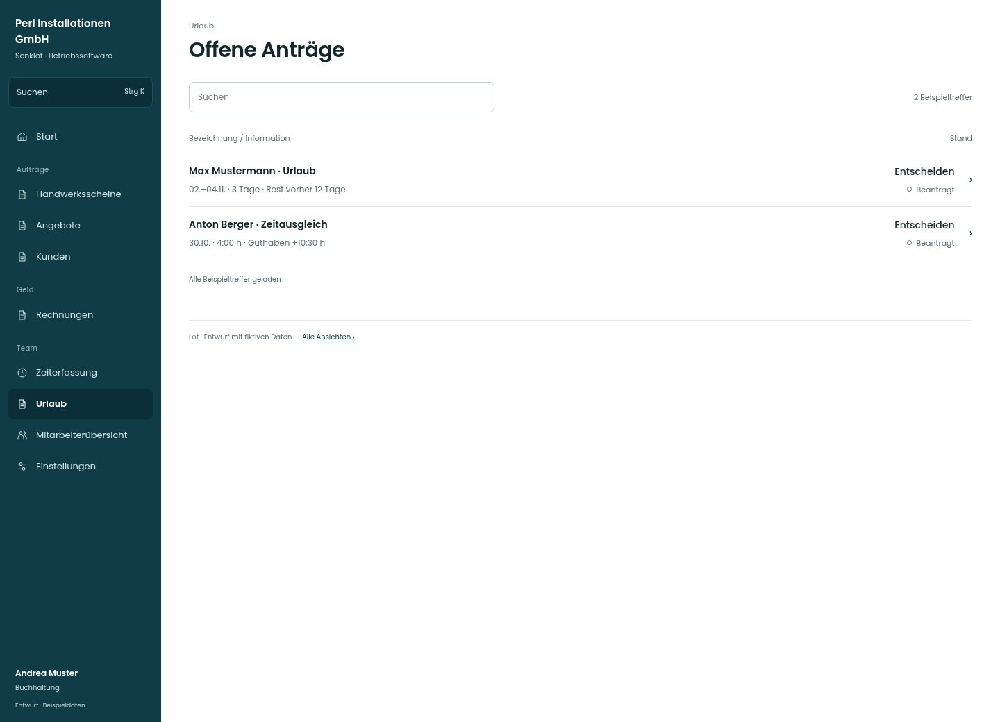

# Offene Anträge

[Zur Übersicht](../README.md) · [Bereich: Urlaub](../bereiche/urlaub.md)

**Urlaub · Buchhaltung · /vacations · Entscheidungen**

Gestaltungsentwurf mit fiktiven Beispieldaten. Aktionen und Datenänderungen sind lokal simuliert, ohne Backend.

[Desktop](../bilder/112-urlaub-entscheiden-desktop.jpg) · [Tablet](../bilder/112-urlaub-entscheiden-tablet.jpg) · [Mobil](../bilder/112-urlaub-entscheiden-mobil.jpg)

## Aufbau

Älteste offene Anträge und konkrete Anspruchsdaten zeigen; Zuständigkeit und Verbot beiläufiger Selbstfreigabe erhalten.

## Vorhandene Funktionen für die spätere Umsetzung erhalten

- Genehmiger betrieblich konfiguriert
- Eigene Anträge nicht beiläufig selbst genehmigen
- Älteste zuerst
- Sonderurlaub/Pflege separat bestätigen

## Quellen

Quellstand: `3e49090`.
- [src/features/vacations/VacationsView.tsx](https://github.com/juliandeutsch22/Prototype-App-Installateure/blob/3e49090d4054ebbd3ecbce6ab583bb944c2c0770/src/features/vacations/VacationsView.tsx)
- [src/features/vacations/FreistellungenBestaetigen.tsx](https://github.com/juliandeutsch22/Prototype-App-Installateure/blob/3e49090d4054ebbd3ecbce6ab583bb944c2c0770/src/features/vacations/FreistellungenBestaetigen.tsx)

Die Screens zeigen die vorgesehenen Bedienwege. Reale Speicherung, vollständige Rollenprüfung, Berechnungen, Exporte, Benachrichtigungen und Integrationen müssen bei einer Umsetzung gegen die App geprüft werden.
