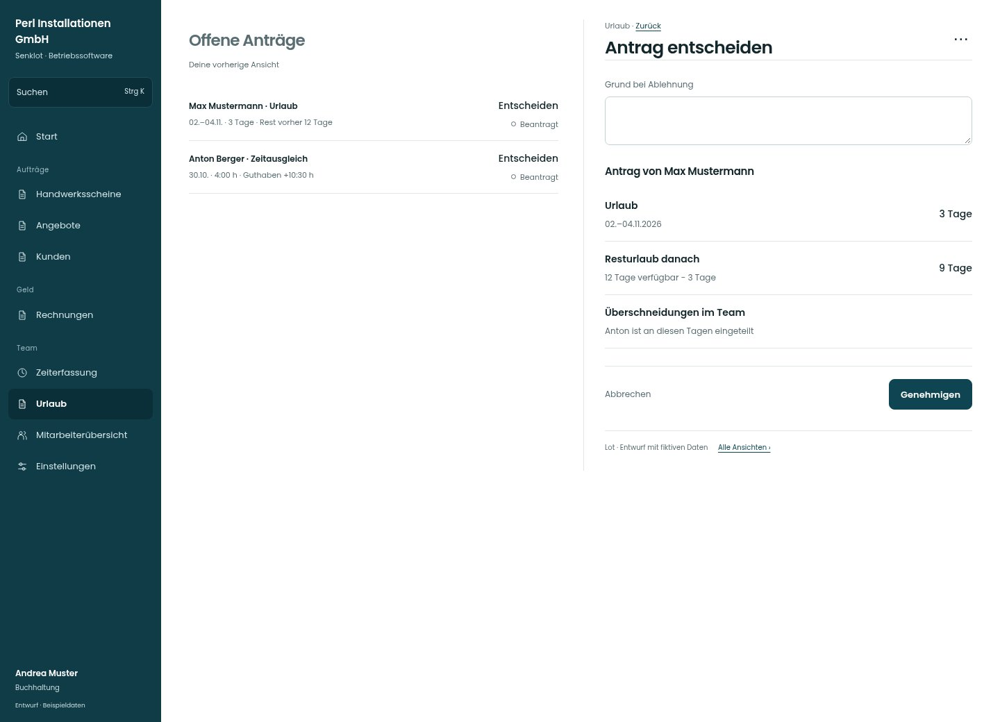

# Antrag entscheiden

[Zur Übersicht](../README.md) · [Bereich: Urlaub](../bereiche/urlaub.md)

**Urlaub · Buchhaltung · /vacations · Entscheidung**

Gestaltungsentwurf mit fiktiven Beispieldaten. Aktionen und Datenänderungen sind lokal simuliert, ohne Backend.

[Desktop](../bilder/113-urlaub-entscheidung-desktop.jpg) · [Tablet](../bilder/113-urlaub-entscheidung-tablet.jpg) · [Mobil](../bilder/113-urlaub-entscheidung-mobil.jpg)

## Aufbau

Anspruch und Teamüberschneidung vor Entscheidung zeigen; Ablehnen mit Begründung als sichtbare Alternative statt versteckter Hauptaktion.

## Vorhandene Funktionen für die spätere Umsetzung erhalten

- Entscheidungsrecht geprüft
- Kein neuer Kapazitäts-/Anspruchsalgorithmus
- Fehlende Auskunft als unbekannt anzeigen

## Felder im Beispiel

- Grund bei Ablehnung

## Aktionen

- Genehmigen
- Mit Begründung ablehnen

## Quellen

Quellstand: `3e49090`.
- [src/features/vacations/VacationsView.tsx](https://github.com/juliandeutsch22/Prototype-App-Installateure/blob/3e49090d4054ebbd3ecbce6ab583bb944c2c0770/src/features/vacations/VacationsView.tsx)
- [src/features/vacations/FreistellungenBestaetigen.tsx](https://github.com/juliandeutsch22/Prototype-App-Installateure/blob/3e49090d4054ebbd3ecbce6ab583bb944c2c0770/src/features/vacations/FreistellungenBestaetigen.tsx)

Die Screens zeigen die vorgesehenen Bedienwege. Reale Speicherung, vollständige Rollenprüfung, Berechnungen, Exporte, Benachrichtigungen und Integrationen müssen bei einer Umsetzung gegen die App geprüft werden.
