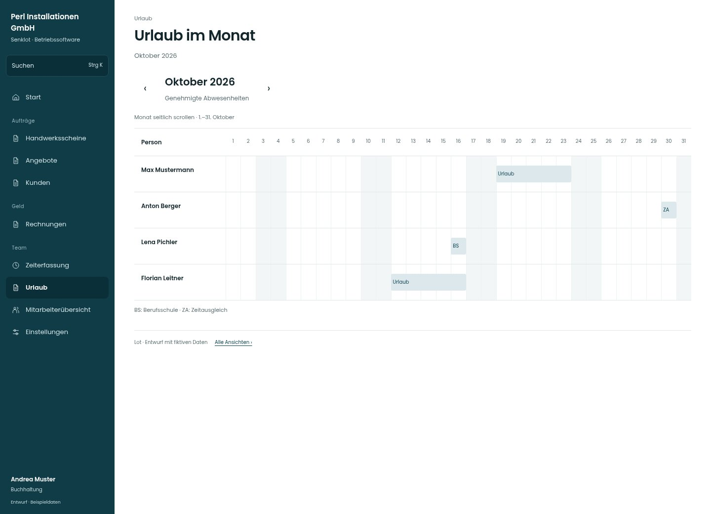

# Urlaub im Monat

[Zur Übersicht](../README.md) · [Bereich: Urlaub](../bereiche/urlaub.md)

**Urlaub · Buchhaltung · /vacations · Monatsübersicht**

Gestaltungsentwurf mit fiktiven Beispieldaten. Aktionen und Datenänderungen sind lokal simuliert, ohne Backend.

[Desktop](../bilder/190-urlaub-monat-desktop.jpg) · [Tablet](../bilder/190-urlaub-monat-tablet.jpg) · [Mobil](../bilder/190-urlaub-monat-mobil.jpg)

## Aufbau

Abwesenheitsübersicht als eigener Lesekontext; eine Abwesenheit ist keine freie Kapazität und braucht keine Planungsaktion.

## Vorhandene Funktionen für die spätere Umsetzung erhalten

- Nur für berechtigte Büroansicht
- Urlaub/Abwesenheit nicht mit freier Kapazität gleichsetzen

## Quellen

Quellstand: `3e49090`.
- [src/features/vacations/UrlaubMonat.tsx](https://github.com/juliandeutsch22/Prototype-App-Installateure/blob/3e49090d4054ebbd3ecbce6ab583bb944c2c0770/src/features/vacations/UrlaubMonat.tsx)

Die Screens zeigen die vorgesehenen Bedienwege. Reale Speicherung, vollständige Rollenprüfung, Berechnungen, Exporte, Benachrichtigungen und Integrationen müssen bei einer Umsetzung gegen die App geprüft werden.
