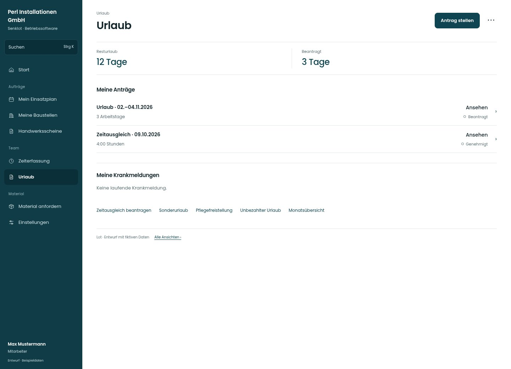

# Urlaub

[Zur Übersicht](../README.md) · [Bereich: Urlaub](../bereiche/urlaub.md)

**Urlaub · Mitarbeiter · /vacations**

Gestaltungsentwurf mit fiktiven Beispieldaten. Aktionen und Datenänderungen sind lokal simuliert, ohne Backend.

[Desktop](../bilder/105-urlaub-desktop.jpg) · [Tablet](../bilder/105-urlaub-tablet.jpg) · [Mobil](../bilder/105-urlaub-mobil.jpg)

## Aufbau

Resturlaub und Antragsstand klar trennen; Antragsarten als direkte Wege ergänzen, ohne Krankmeldung zum Urlaub zu machen.

## Vorhandene Funktionen für die spätere Umsetzung erhalten

- Jede Rolle eigener Antrag
- Sonderurlaub/Pflege/unbezahlt
- Betriebsurlaub/Übertrag/Verfall
- Eigene Krankmeldungen ändern

## Aktionen

- Antrag stellen
- Krank melden

## Quellen

Quellstand: `3e49090`.
- [src/features/vacations/VacationsView.tsx](https://github.com/juliandeutsch22/Prototype-App-Installateure/blob/3e49090d4054ebbd3ecbce6ab583bb944c2c0770/src/features/vacations/VacationsView.tsx)
- [src/features/vacations/FreistellungListe.tsx](https://github.com/juliandeutsch22/Prototype-App-Installateure/blob/3e49090d4054ebbd3ecbce6ab583bb944c2c0770/src/features/vacations/FreistellungListe.tsx)

Die Screens zeigen die vorgesehenen Bedienwege. Reale Speicherung, vollständige Rollenprüfung, Berechnungen, Exporte, Benachrichtigungen und Integrationen müssen bei einer Umsetzung gegen die App geprüft werden.
