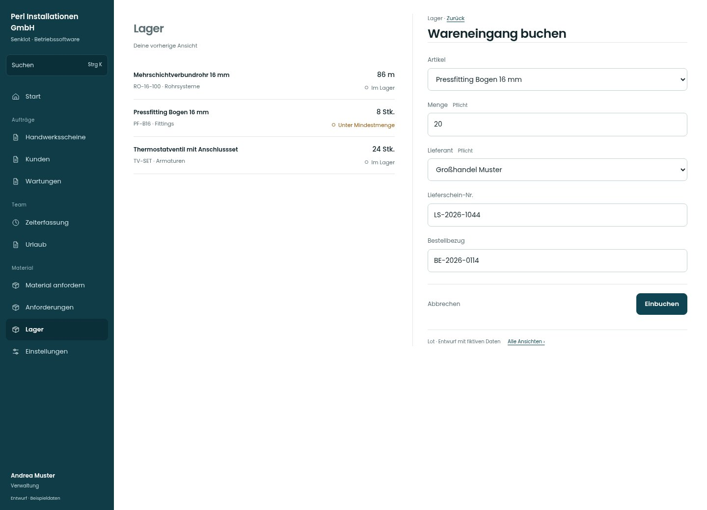

# Wareneingang buchen

[Zur Übersicht](../README.md) · [Bereich: Lager](../bereiche/lager.md)

**Lager · Verwaltung · /lager · Wareneingang**

Gestaltungsentwurf mit fiktiven Beispieldaten. Aktionen und Datenänderungen sind lokal simuliert, ohne Backend.

[Desktop](../bilder/073-wareneingang-desktop.jpg) · [Tablet](../bilder/073-wareneingang-tablet.jpg) · [Mobil](../bilder/073-wareneingang-mobil.jpg)

## Aufbau

Artikel und Menge zuerst, Lieferant/Lieferschein/Bestellbezug zusammen; Pflichtlieferant und Mengenprüfung nicht ausblenden.

## Vorhandene Funktionen für die spätere Umsetzung erhalten

- Lieferant Pflicht
- Freier Lieferant möglich
- Mengen-/Einheitenprüfung
- Bewegungsprotokoll

## Felder im Beispiel

- Artikel
- Menge (Pflichtfeld)
- Lieferant (Pflichtfeld)
- Lieferschein-Nr.
- Bestellbezug

## Aktionen

- Einbuchen

## Quellen

Quellstand: `3e49090`.
- [src/features/orders/LagerDialoge.tsx](https://github.com/juliandeutsch22/Prototype-App-Installateure/blob/3e49090d4054ebbd3ecbce6ab583bb944c2c0770/src/features/orders/LagerDialoge.tsx)

Die Screens zeigen die vorgesehenen Bedienwege. Reale Speicherung, vollständige Rollenprüfung, Berechnungen, Exporte, Benachrichtigungen und Integrationen müssen bei einer Umsetzung gegen die App geprüft werden.
