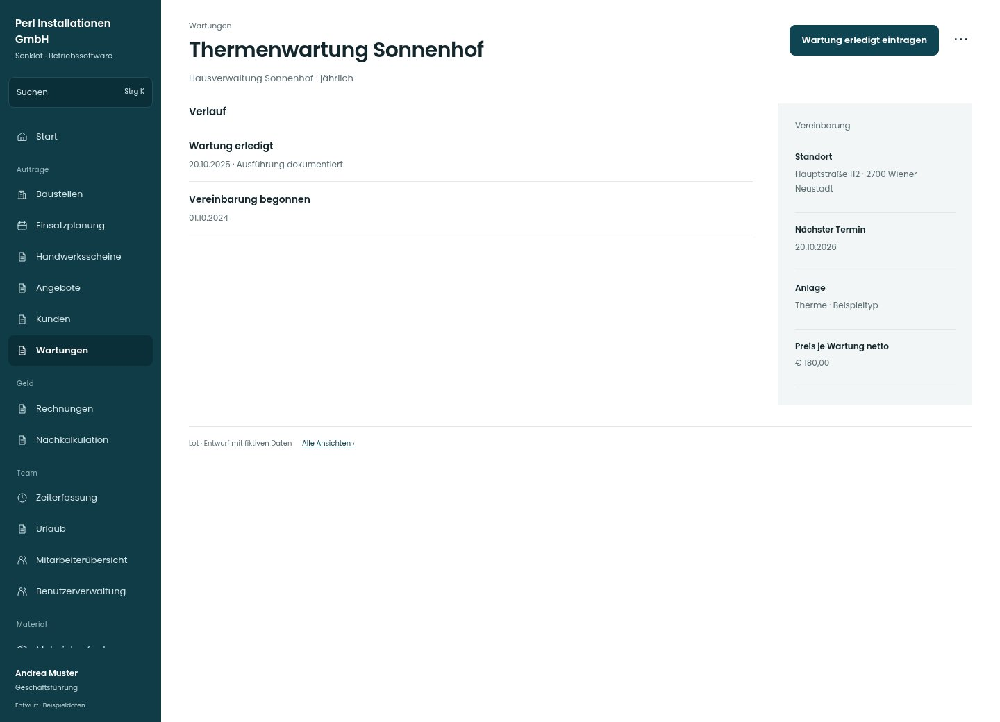

# Thermenwartung Sonnenhof

[Zur Übersicht](../README.md) · [Bereich: Wartungen](../bereiche/wartungen.md)

**Wartungen · Geschäftsführung · /wartungen · Vereinbarung**

Gestaltungsentwurf mit fiktiven Beispieldaten. Aktionen und Datenänderungen sind lokal simuliert, ohne Backend.

[Desktop](../bilder/186-wartung-detail-desktop.jpg) · [Tablet](../bilder/186-wartung-detail-tablet.jpg) · [Mobil](../bilder/186-wartung-detail-mobil.jpg)

## Aufbau

Nächster Termin und Ausführungshistorie zuerst prüfen; bestehende Historie nicht mit neuem Datum überschreiben.

## Vorhandene Funktionen für die spätere Umsetzung erhalten

- Nicht für Verwaltung schreibbar
- Keine Historie überschreiben
- Baustelle aus Ausführung erreichbar
- Das gezeigte Aktionsbeispiel ist Leitung; Verwaltung erhält diese Aktionen nicht

## Aktionen

- Wartung erledigt eintragen
- Bearbeiten
- Wartung löschen

## Quellen

Quellstand: `3e49090`.
- [src/features/maintenance/WartungenView.tsx](https://github.com/juliandeutsch22/Prototype-App-Installateure/blob/3e49090d4054ebbd3ecbce6ab583bb944c2c0770/src/features/maintenance/WartungenView.tsx)
- [src/features/maintenance/WartungVerlauf.tsx](https://github.com/juliandeutsch22/Prototype-App-Installateure/blob/3e49090d4054ebbd3ecbce6ab583bb944c2c0770/src/features/maintenance/WartungVerlauf.tsx)

Die Screens zeigen die vorgesehenen Bedienwege. Reale Speicherung, vollständige Rollenprüfung, Berechnungen, Exporte, Benachrichtigungen und Integrationen müssen bei einer Umsetzung gegen die App geprüft werden.
