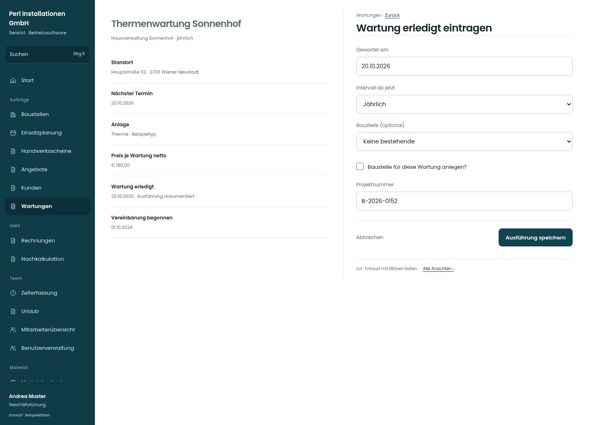

# Wartung erledigt eintragen

[Zur Übersicht](../README.md) · [Bereich: Wartungen](../bereiche/wartungen.md)

**Wartungen · Geschäftsführung · /wartungen · Ausführung**

Gestaltungsentwurf mit fiktiven Beispieldaten. Aktionen und Datenänderungen sind lokal simuliert, ohne Backend.

[Desktop](../bilder/188-wartung-erledigt-desktop.jpg) · [Tablet](../bilder/188-wartung-erledigt-tablet.jpg) · [Mobil](../bilder/188-wartung-erledigt-mobil.jpg)

## Aufbau

Ausführungsdatum und optionaler Baustellenbezug vor Bestätigung; neue Ausführung statt Überschreiben der Historie.

## Vorhandene Funktionen für die spätere Umsetzung erhalten

- Neue Ausführung statt Datum überschreiben
- Optionale Wartungsbaustelle
- Leistungs-/Rechnungsweg bleibt bestehen

## Felder im Beispiel

- Gewartet am
- Intervall ab jetzt
- Baustelle (optional)
- Baustelle für diese Wartung anlegen?
- Projektnummer

## Aktionen

- Ausführung speichern

## Quellen

Quellstand: `3e49090`.
- [src/features/maintenance/WartungenView.tsx](https://github.com/juliandeutsch22/Prototype-App-Installateure/blob/3e49090d4054ebbd3ecbce6ab583bb944c2c0770/src/features/maintenance/WartungenView.tsx)

Die Screens zeigen die vorgesehenen Bedienwege. Reale Speicherung, vollständige Rollenprüfung, Berechnungen, Exporte, Benachrichtigungen und Integrationen müssen bei einer Umsetzung gegen die App geprüft werden.
