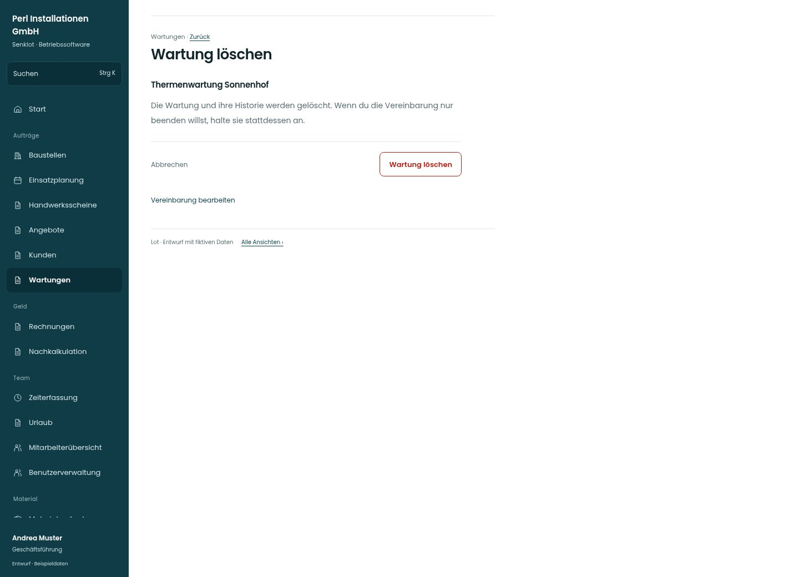

# Wartung löschen

[Zur Übersicht](../README.md) · [Bereich: Wartungen](../bereiche/wartungen.md)

**Wartungen · Geschäftsführung · /wartungen · Löschen**

Gestaltungsentwurf mit fiktiven Beispieldaten. Aktionen und Datenänderungen sind lokal simuliert, ohne Backend.

[Desktop](../bilder/189-wartung-loeschen-desktop.jpg) · [Tablet](../bilder/189-wartung-loeschen-tablet.jpg) · [Mobil](../bilder/189-wartung-loeschen-mobil.jpg)

## Aufbau

Die Löschung entfernt laut WartungenView auch die Historie; diese konkrete Wirkung und das bloße Anhalten als Alternative vor Bestätigung nennen.

## Vorhandene Funktionen für die spätere Umsetzung erhalten

- Siehe Quellcode und Seitenübersicht.

## Aktionen

- Wartung löschen

## Quellen

Quellstand: `3e49090`.
- [src/features/maintenance/WartungenView.tsx](https://github.com/juliandeutsch22/Prototype-App-Installateure/blob/3e49090d4054ebbd3ecbce6ab583bb944c2c0770/src/features/maintenance/WartungenView.tsx)

Die Screens zeigen die vorgesehenen Bedienwege. Reale Speicherung, vollständige Rollenprüfung, Berechnungen, Exporte, Benachrichtigungen und Integrationen müssen bei einer Umsetzung gegen die App geprüft werden.
