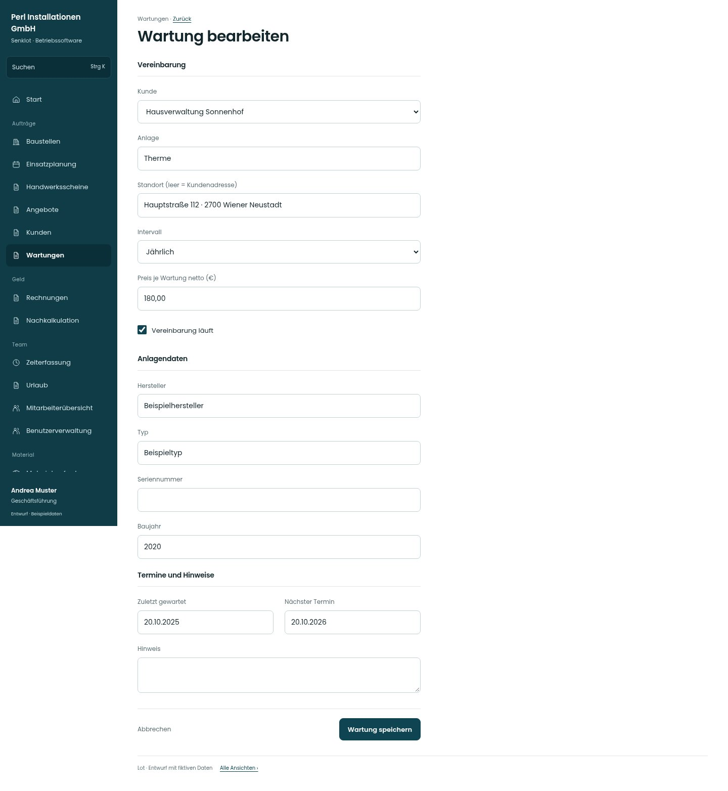

# Wartung bearbeiten

[Zur Übersicht](../README.md) · [Bereich: Wartungen](../bereiche/wartungen.md)

**Wartungen · Geschäftsführung · /wartungen · Formular**

Gestaltungsentwurf mit fiktiven Beispieldaten. Aktionen und Datenänderungen sind lokal simuliert, ohne Backend.

[Desktop](../bilder/187-wartung-neu-desktop.jpg) · [Tablet](../bilder/187-wartung-neu-tablet.jpg) · [Mobil](../bilder/187-wartung-neu-mobil.jpg)

## Aufbau

Vereinbarung, Anlagendaten und Termine/Hinweise gruppieren; Fälligkeit folgt der bestehenden Intervallberechnung.

## Vorhandene Funktionen für die spätere Umsetzung erhalten

- Fälligkeit aus Intervall wie bisher
- Verwaltung liest nur

## Felder im Beispiel

- Kunde
- Anlage
- Standort (leer = Kundenadresse)
- Intervall
- Hersteller
- Typ
- Seriennummer
- Baujahr
- Preis je Wartung netto (€)
- Zuletzt gewartet
- Nächster Termin
- Vereinbarung läuft
- Hinweis

## Aktionen

- Wartung speichern

## Quellen

Quellstand: `3e49090`.
- [src/features/maintenance/WartungenView.tsx](https://github.com/juliandeutsch22/Prototype-App-Installateure/blob/3e49090d4054ebbd3ecbce6ab583bb944c2c0770/src/features/maintenance/WartungenView.tsx)

Die Screens zeigen die vorgesehenen Bedienwege. Reale Speicherung, vollständige Rollenprüfung, Berechnungen, Exporte, Benachrichtigungen und Integrationen müssen bei einer Umsetzung gegen die App geprüft werden.
