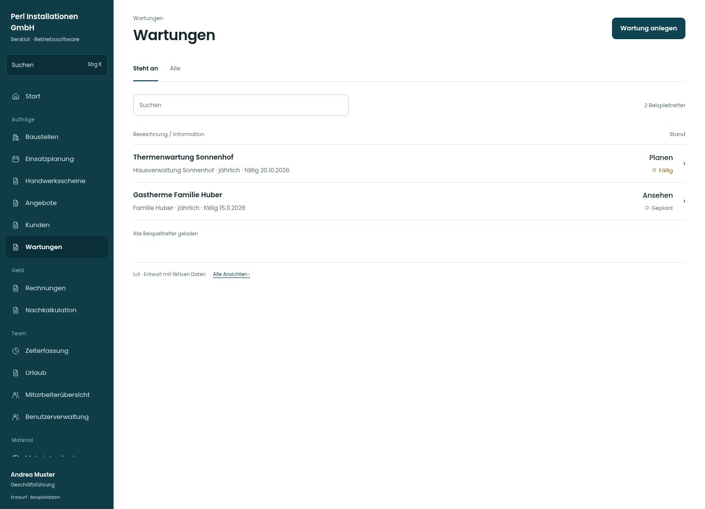

# Wartungen

[Zur Übersicht](../README.md) · [Bereich: Wartungen](../bereiche/wartungen.md)

**Wartungen · Geschäftsführung · /wartungen**

Gestaltungsentwurf mit fiktiven Beispieldaten. Aktionen und Datenänderungen sind lokal simuliert, ohne Backend.

[Desktop](../bilder/185-wartungen-desktop.jpg) · [Tablet](../bilder/185-wartungen-tablet.jpg) · [Mobil](../bilder/185-wartungen-mobil.jpg)

## Aufbau

Anlage, Kunde, Intervall und Fälligkeit tragen die Liste; Verwaltung erhält weiterhin nur zulässige Lesewege.

## Vorhandene Funktionen für die spätere Umsetzung erhalten

- Verwaltung nur lesend
- Kundenbezug unabhängig von Baustellen
- Intervall und Fälligkeit
- Ausführungshistorie
- Das gezeigte Aktionsbeispiel ist Leitung; Verwaltung erhält diese Aktionen nicht

## Register und Filter

- Steht an → [wartungen](wartungen.md)
- Alle → [wartungen-filter-1](wartungen-filter-1.md)

## Aktionen

- Wartung anlegen

## Quellen

Quellstand: `3e49090`.
- [src/features/maintenance/WartungenView.tsx](https://github.com/juliandeutsch22/Prototype-App-Installateure/blob/3e49090d4054ebbd3ecbce6ab583bb944c2c0770/src/features/maintenance/WartungenView.tsx)
- [src/features/maintenance/WartungVerlauf.tsx](https://github.com/juliandeutsch22/Prototype-App-Installateure/blob/3e49090d4054ebbd3ecbce6ab583bb944c2c0770/src/features/maintenance/WartungVerlauf.tsx)

Die Screens zeigen die vorgesehenen Bedienwege. Reale Speicherung, vollständige Rollenprüfung, Berechnungen, Exporte, Benachrichtigungen und Integrationen müssen bei einer Umsetzung gegen die App geprüft werden.
