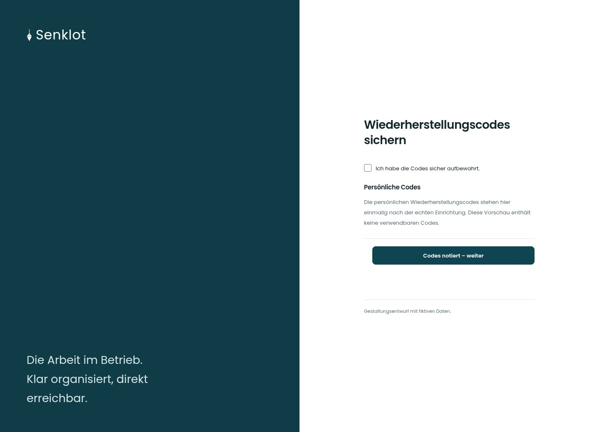

# Wiederherstellungscodes sichern

[Zur Übersicht](../README.md) · [Bereich: Zugang](../bereiche/zugang.md)

**Zugang · Geschäftsführung · Nach Zwei-Faktor-Einrichtung**

Gestaltungsentwurf mit fiktiven Beispieldaten. Aktionen und Datenänderungen sind lokal simuliert, ohne Backend.

[Desktop](../bilder/008-wiederherstellungscodes-desktop.jpg) · [Tablet](../bilder/008-wiederherstellungscodes-tablet.jpg) · [Mobil](../bilder/008-wiederherstellungscodes-mobil.jpg)

## Aufbau

Einmalige Anzeige und ausdrückliche Bestätigung erhalten; die Vorschau behauptet keine echten Codes.

## Vorhandene Funktionen für die spätere Umsetzung erhalten

- Codes bleiben bis zur ausdrücklichen Bestätigung sichtbar
- Keine echten Codes im Entwurf

## Felder im Beispiel

- Ich habe die Codes sicher aufbewahrt.

## Aktionen

- Codes notiert – weiter

## Quellen

Quellstand: `3e49090`.
- [src/features/auth/ZweiFaktorEinrichten.tsx](https://github.com/juliandeutsch22/Prototype-App-Installateure/blob/3e49090d4054ebbd3ecbce6ab583bb944c2c0770/src/features/auth/ZweiFaktorEinrichten.tsx)

Die Screens zeigen die vorgesehenen Bedienwege. Reale Speicherung, vollständige Rollenprüfung, Berechnungen, Exporte, Benachrichtigungen und Integrationen müssen bei einer Umsetzung gegen die App geprüft werden.
