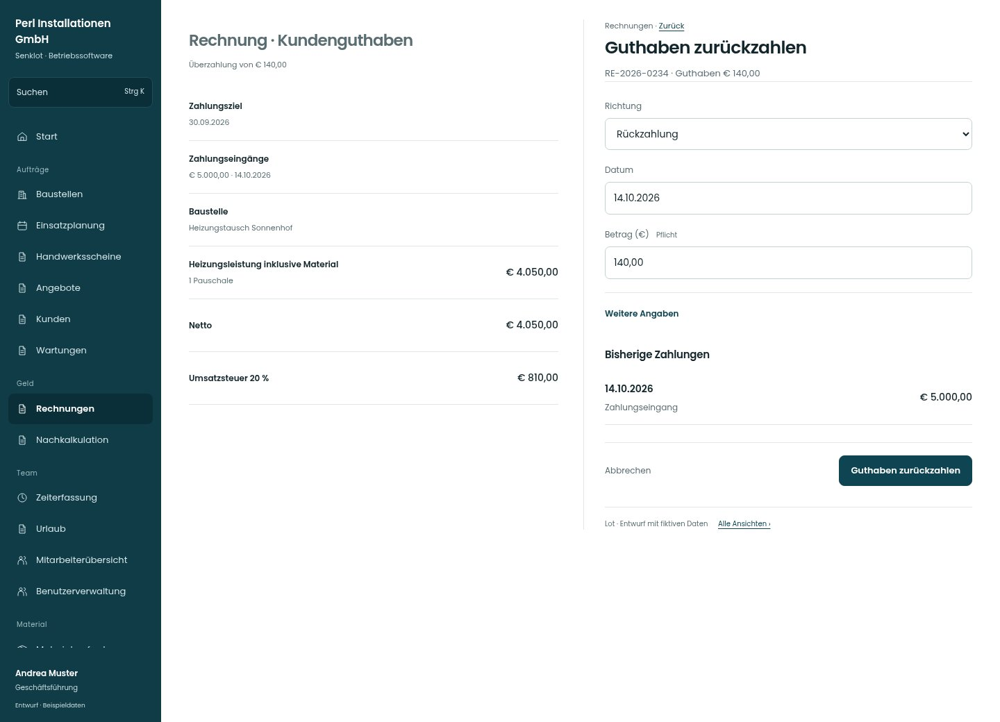

# Guthaben zurückzahlen

[Zur Übersicht](../README.md) · [Bereich: Rechnungen](../bereiche/rechnungen.md)

**Rechnungen · Geschäftsführung · /invoices · Zahlungen**

Gestaltungsentwurf mit fiktiven Beispieldaten. Aktionen und Datenänderungen sind lokal simuliert, ohne Backend.

[Desktop](../bilder/216-zahlung-rueckzahlung-desktop.jpg) · [Tablet](../bilder/216-zahlung-rueckzahlung-tablet.jpg) · [Mobil](../bilder/216-zahlung-rueckzahlung-mobil.jpg)

## Aufbau

Bedingten Arbeitszustand bzw. getrennte Aufgabe explizit zeigen, ohne vorhandene Ansicht umzudeuten.

## Vorhandene Funktionen für die spätere Umsetzung erhalten

- Teilzahlung/Rückzahlung
- Überzahlung als Guthaben
- Skontobedingungen
- Protokoll und Korrekturwege

## Felder im Beispiel

- Richtung
- Datum
- Betrag (€) (Pflichtfeld)
- Hinweis

## Aktionen

- Guthaben zurückzahlen

## Quellen

Quellstand: `3e49090`.
- [src/features/invoices/InvoicesView.tsx](https://github.com/juliandeutsch22/Prototype-App-Installateure/blob/3e49090d4054ebbd3ecbce6ab583bb944c2c0770/src/features/invoices/InvoicesView.tsx)

Die Screens zeigen die vorgesehenen Bedienwege. Reale Speicherung, vollständige Rollenprüfung, Berechnungen, Exporte, Benachrichtigungen und Integrationen müssen bei einer Umsetzung gegen die App geprüft werden.
