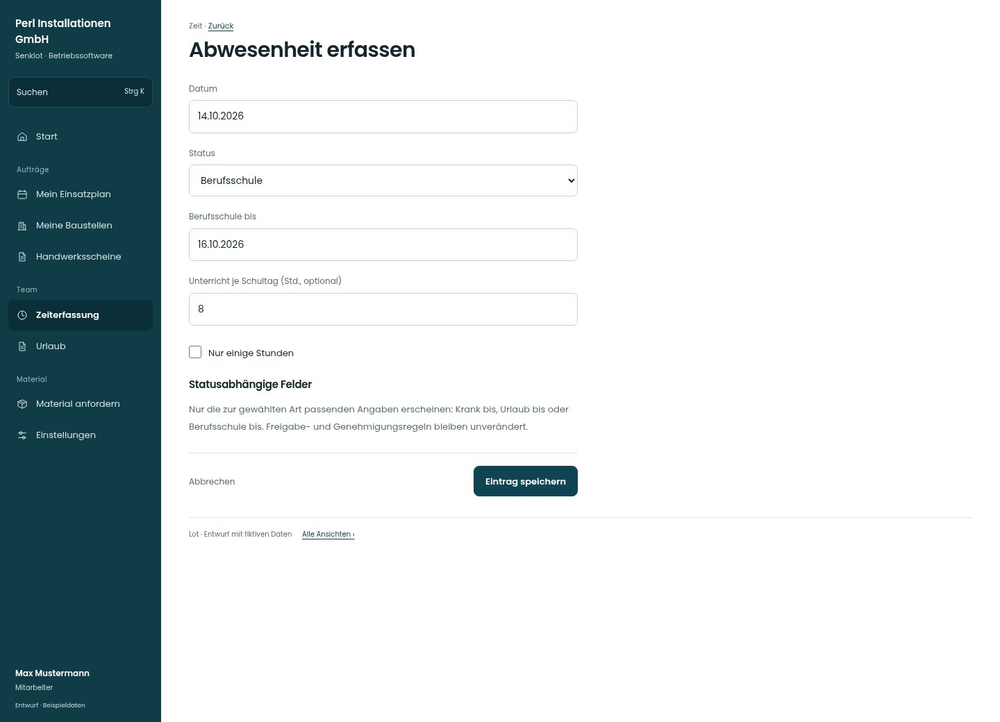

# Abwesenheit erfassen

[Zur Übersicht](../README.md) · [Bereich: Zeit](../bereiche/zeit.md)

**Zeit · Mitarbeiter · /time · Statusabhängige Eingabe**

Gestaltungsentwurf mit fiktiven Beispieldaten. Aktionen und Datenänderungen sind lokal simuliert, ohne Backend.

[Desktop](../bilder/191-zeit-abwesenheit-desktop.jpg) · [Tablet](../bilder/191-zeit-abwesenheit-tablet.jpg) · [Mobil](../bilder/191-zeit-abwesenheit-mobil.jpg)

## Aufbau

Zur Statusart passende Zeitfelder zeigen; stundenweise Angaben nur bei Bedarf und kein Umgehen eines genehmigungspflichtigen Antrags.

## Vorhandene Funktionen für die spätere Umsetzung erhalten

- Kein Umgehen eines Urlaubsantrags durch Zeitstatus
- Jugendliche und Unterricht
- Stundenweise Abwesenheit

## Felder im Beispiel

- Datum
- Status
- Berufsschule bis
- Unterricht je Schultag (Std., optional)
- Nur einige Stunden
- Frei von
- Frei bis

## Aktionen

- Eintrag speichern

## Quellen

Quellstand: `3e49090`.
- [src/features/time/TimeForm.tsx](https://github.com/juliandeutsch22/Prototype-App-Installateure/blob/3e49090d4054ebbd3ecbce6ab583bb944c2c0770/src/features/time/TimeForm.tsx)

Die Screens zeigen die vorgesehenen Bedienwege. Reale Speicherung, vollständige Rollenprüfung, Berechnungen, Exporte, Benachrichtigungen und Integrationen müssen bei einer Umsetzung gegen die App geprüft werden.
