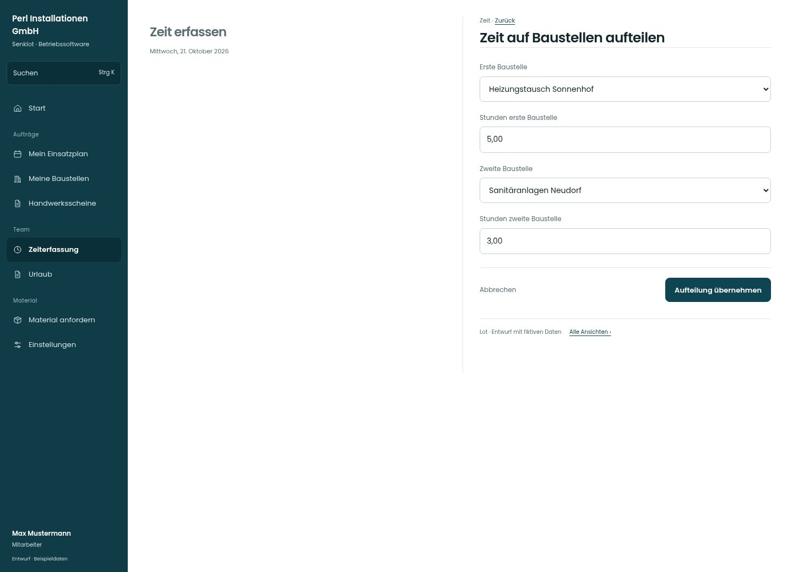

# Zeit auf Baustellen aufteilen

[Zur Übersicht](../README.md) · [Bereich: Zeit](../bereiche/zeit.md)

**Zeit · Mitarbeiter · /time · Aufteilen**

Gestaltungsentwurf mit fiktiven Beispieldaten. Aktionen und Datenänderungen sind lokal simuliert, ohne Backend.

[Desktop](../bilder/103-zeit-aufteilen-desktop.jpg) · [Tablet](../bilder/103-zeit-aufteilen-tablet.jpg) · [Mobil](../bilder/103-zeit-aufteilen-mobil.jpg)

## Aufbau

Ursprüngliche Gesamtdauer und verteilte Summe im selben Blick halten; keine zusätzlichen Stunden durch die Aufteilung erzeugen.

## Vorhandene Funktionen für die spätere Umsetzung erhalten

- Summe muss ursprünglicher Zeit entsprechen
- Keine doppelten Stunden

## Felder im Beispiel

- Erste Baustelle
- Stunden erste Baustelle
- Zweite Baustelle
- Stunden zweite Baustelle

## Aktionen

- Aufteilung übernehmen

## Quellen

Quellstand: `3e49090`.
- [src/features/time/AufteilenDialog.tsx](https://github.com/juliandeutsch22/Prototype-App-Installateure/blob/3e49090d4054ebbd3ecbce6ab583bb944c2c0770/src/features/time/AufteilenDialog.tsx)

Die Screens zeigen die vorgesehenen Bedienwege. Reale Speicherung, vollständige Rollenprüfung, Berechnungen, Exporte, Benachrichtigungen und Integrationen müssen bei einer Umsetzung gegen die App geprüft werden.
