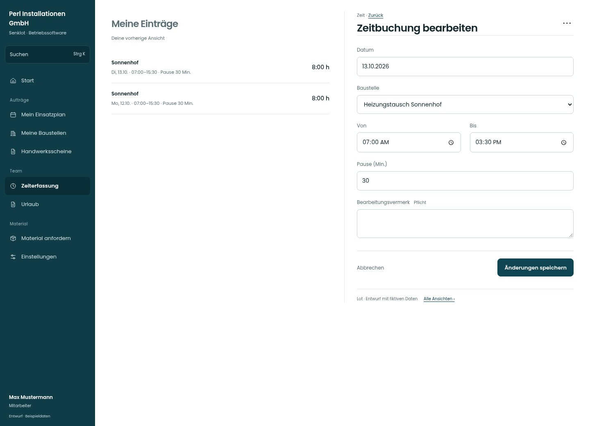

# Zeitbuchung bearbeiten

[Zur Übersicht](../README.md) · [Bereich: Zeit](../bereiche/zeit.md)

**Zeit · Mitarbeiter · /time · Bearbeiten**

Gestaltungsentwurf mit fiktiven Beispieldaten. Aktionen und Datenänderungen sind lokal simuliert, ohne Backend.

[Desktop](../bilder/102-zeit-bearbeiten-desktop.jpg) · [Tablet](../bilder/102-zeit-bearbeiten-tablet.jpg) · [Mobil](../bilder/102-zeit-bearbeiten-mobil.jpg)

## Aufbau

Zeitfelder und Korrekturvermerk vor Speichern; fremde und verrechnete Buchungen weiter nach bestehenden Rechten schützen.

## Vorhandene Funktionen für die spätere Umsetzung erhalten

- Bearbeitungsvermerk nach Bestand
- Fremdbuchung nur mit Korrekturrecht
- Löschen bestätigt

## Felder im Beispiel

- Datum
- Baustelle
- Von
- Bis
- Pause (Min.)
- Bearbeitungsvermerk (Pflichtfeld)

## Aktionen

- Änderungen speichern
- Eintrag löschen

## Quellen

Quellstand: `3e49090`.
- [src/features/time/TimeView.tsx](https://github.com/juliandeutsch22/Prototype-App-Installateure/blob/3e49090d4054ebbd3ecbce6ab583bb944c2c0770/src/features/time/TimeView.tsx)
- [src/features/time/TimeForm.tsx](https://github.com/juliandeutsch22/Prototype-App-Installateure/blob/3e49090d4054ebbd3ecbce6ab583bb944c2c0770/src/features/time/TimeForm.tsx)

Die Screens zeigen die vorgesehenen Bedienwege. Reale Speicherung, vollständige Rollenprüfung, Berechnungen, Exporte, Benachrichtigungen und Integrationen müssen bei einer Umsetzung gegen die App geprüft werden.
