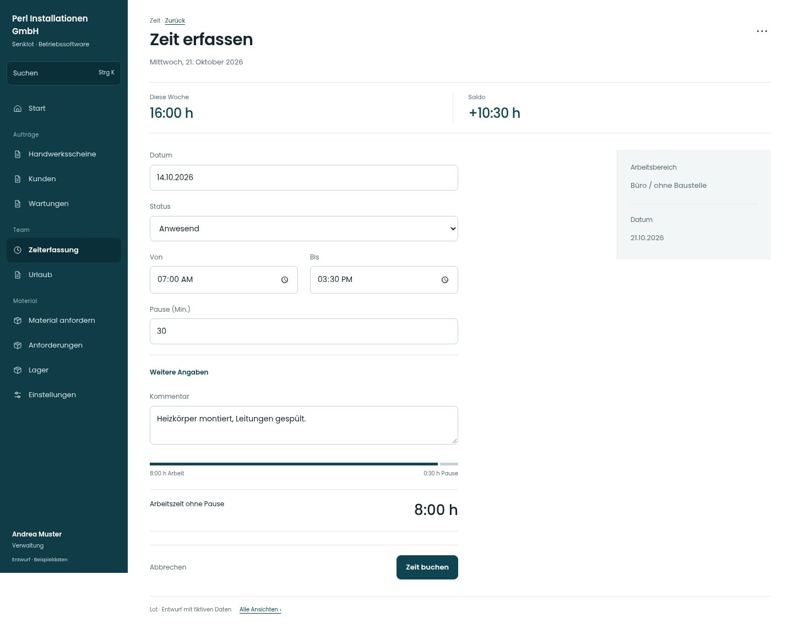

# Zeit erfassen

[Zur Übersicht](../README.md) · [Bereich: Zeit](../bereiche/zeit.md)

**Zeit · Verwaltung · /time**

Gestaltungsentwurf mit fiktiven Beispieldaten. Aktionen und Datenänderungen sind lokal simuliert, ohne Backend.

[Desktop](../bilder/099-zeit-buero-desktop.jpg) · [Tablet](../bilder/099-zeit-buero-tablet.jpg) · [Mobil](../bilder/099-zeit-buero-mobil.jpg)

## Aufbau

Kurze Büroerfassung ohne unnötige Baustellen- und Zuschlagsfelder erhalten; dieselbe verständliche Dauerrückmeldung verwenden.

## Vorhandene Funktionen für die spätere Umsetzung erhalten

- Alle Rollen eigene Zeit
- Monteur immer volle Erfassung
- Büro keine unnötigen Baustellen-/Zuschlagsfelder
- Leitung kann erweitern
- Jugendliche/Unterricht/Nachtzeitregeln
- Abwesenheiten stunden-/tageweise

## Felder im Beispiel

- Datum
- Status
- Von
- Bis
- Pause (Min.)
- Kommentar

## Aktionen

- Zeit buchen
- Meine Einträge

## Quellen

Quellstand: `3e49090`.
- [src/features/time/TimeView.tsx](https://github.com/juliandeutsch22/Prototype-App-Installateure/blob/3e49090d4054ebbd3ecbce6ab583bb944c2c0770/src/features/time/TimeView.tsx)
- [src/features/time/TimeForm.tsx](https://github.com/juliandeutsch22/Prototype-App-Installateure/blob/3e49090d4054ebbd3ecbce6ab583bb944c2c0770/src/features/time/TimeForm.tsx)

Die Screens zeigen die vorgesehenen Bedienwege. Reale Speicherung, vollständige Rollenprüfung, Berechnungen, Exporte, Benachrichtigungen und Integrationen müssen bei einer Umsetzung gegen die App geprüft werden.
