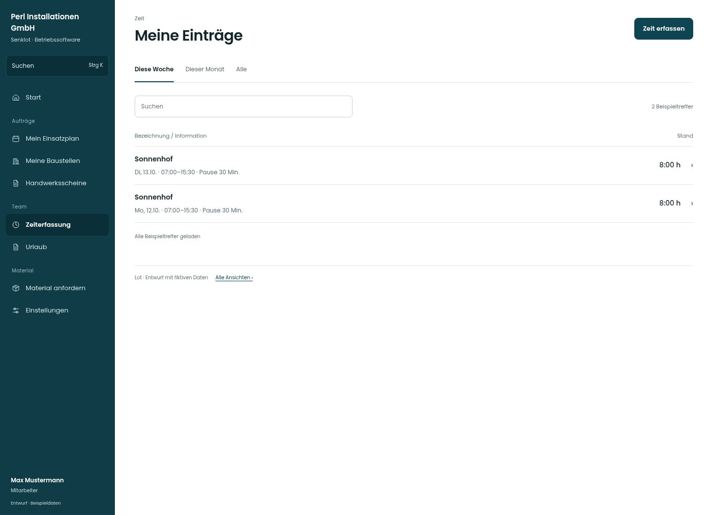

# Meine Einträge

[Zur Übersicht](../README.md) · [Bereich: Zeit](../bereiche/zeit.md)

**Zeit · Mitarbeiter · /time · Einträge**

Gestaltungsentwurf mit fiktiven Beispieldaten. Aktionen und Datenänderungen sind lokal simuliert, ohne Backend.

[Desktop](../bilder/101-zeit-eintraege-desktop.jpg) · [Tablet](../bilder/101-zeit-eintraege-tablet.jpg) · [Mobil](../bilder/101-zeit-eintraege-mobil.jpg)

## Aufbau

Datum, Baustelle und Dauer bilden die Liste; erlaubte Bearbeitung und bestätigtes Löschen bleiben am konkreten Eintrag.

## Vorhandene Funktionen für die spätere Umsetzung erhalten

- Ändern/Löschen nur im erlaubten Zeitraum
- Zukünftige Einträge
- Fehlende Tage nicht als Nullstunden tarnen

## Register und Filter

- Diese Woche
- Dieser Monat
- Alle

## Aktionen

- Zeit erfassen

## Quellen

Quellstand: `3e49090`.
- [src/features/time/TimeView.tsx](https://github.com/juliandeutsch22/Prototype-App-Installateure/blob/3e49090d4054ebbd3ecbce6ab583bb944c2c0770/src/features/time/TimeView.tsx)

Die Screens zeigen die vorgesehenen Bedienwege. Reale Speicherung, vollständige Rollenprüfung, Berechnungen, Exporte, Benachrichtigungen und Integrationen müssen bei einer Umsetzung gegen die App geprüft werden.
